# Design and Implementation of an ESP32-Based IoT Home Automation System with Mobile Application Control

**Thesis submitted for the degree of Doctor of Philosophy**

[University Name]
Department of [Department Name]

**By:** [Student Full Name]

**Supervisor:** [Supervisor's Full Name]

---

## Abstract

The proliferation of Internet of Things (IoT) technologies has created opportunities for intelligent home automation systems that enhance comfort, energy efficiency, and security. However, existing commercial solutions often rely on cloud-based architectures that introduce latency, privacy concerns, and single points of failure. This is particularly problematic in environments where internet connectivity is unreliable, as cloud-dependent systems become non-functional during outages. This thesis presents the design, implementation, and evaluation of a locally-controlled IoT home automation system built around the ESP32 microcontroller platform. The system integrates motion-triggered lighting via passive infrared (PIR) sensors, environmental monitoring through temperature and humidity sensing, and relay-based actuator control for multiple domestic devices including lighting circuits and a ceiling fan. A custom mobile application developed using React Native and Expo provides real-time monitoring and control through a local REST API, eliminating cloud dependency while maintaining responsive user interaction. The firmware implements a captive portal for zero-configuration Wi-Fi provisioning, mDNS and UDP-based device discovery for automatic network integration, and a dual-mode control architecture supporting both automated sensor-driven operation and manual user override. The system architecture addresses key challenges in IoT home automation including reliable device discovery on heterogeneous networks, optimistic user interface updates with server-side rollback for responsive control, and fail-safe relay operation through independent power supply design. Experimental validation demonstrates sub-second response times for relay actuation, reliable motion detection with configurable debounce thresholds, and stable environmental monitoring across extended operational periods. The mobile application achieves connection establishment within 3 seconds of network presence and maintains consistent state synchronization through a 1.5-second polling interval with command-lock mechanisms to prevent UI flicker. The total system cost remains below ₦22,500, making it accessible for deployment in resource-constrained environments. This work contributes to the field of IoT home automation by demonstrating that a fully locally-controlled system can achieve comparable functionality to cloud-dependent commercial solutions while offering improved privacy, reduced latency, and enhanced reliability.

---

## Acknowledgements

[Acknowledgements content here]

---

## Table of Contents

- [Chapter 1. Introduction](#chapter-1-introduction)
  - [1.1. Overview](#11-overview)
  - [1.2. Internet of Things and Smart Home Technologies](#12-internet-of-things-and-smart-home-technologies)
  - [1.3. Motivation and Problem Statement](#13-motivation-and-problem-statement)
  - [1.4. Research Objectives](#14-research-objectives)
  - [1.5. Research Contributions](#15-research-contributions)
  - [1.6. Thesis Outline](#16-thesis-outline)
- [Chapter 2. Literature Review](#chapter-2-literature-review)
  - [2.1. Evolution of Home Automation Systems](#21-evolution-of-home-automation-systems)
  - [2.2. IoT Communication Protocols](#22-iot-communication-protocols)
    - [2.2.1. Wi-Fi for Home Automation](#221-wi-fi-for-home-automation)
    - [2.2.2. RESTful API Architecture](#222-restful-api-architecture)
    - [2.2.3. MQTT and Message Queue Protocols](#223-mqtt-and-message-queue-protocols)
  - [2.3. Microcontroller Platforms for IoT](#23-microcontroller-platforms-for-iot)
    - [2.3.1. ESP32 Architecture and Capabilities](#231-esp32-architecture-and-capabilities)
    - [2.3.2. Comparison with Alternative Platforms](#232-comparison-with-alternative-platforms)
  - [2.4. Sensor Technologies for Home Automation](#24-sensor-technologies-for-home-automation)
    - [2.4.1. Passive Infrared Motion Detection](#241-passive-infrared-motion-detection)
    - [2.4.2. Temperature and Humidity Sensing](#242-temperature-and-humidity-sensing)
  - [2.5. Mobile Application Development Frameworks](#25-mobile-application-development-frameworks)
    - [2.5.1. React Native and Cross-Platform Development](#251-react-native-and-cross-platform-development)
    - [2.5.2. Expo Framework for Rapid Prototyping](#252-expo-framework-for-rapid-prototyping)
  - [2.6. Device Discovery Mechanisms](#26-device-discovery-mechanisms)
    - [2.6.1. mDNS and DNS-SD](#261-mdns-and-dns-sd)
    - [2.6.2. UDP Broadcast Discovery](#262-udp-broadcast-discovery)
  - [2.7. Existing Home Automation Solutions](#27-existing-home-automation-solutions)
    - [2.7.1. Commercial Platforms](#271-commercial-platforms)
    - [2.7.2. Open-Source Alternatives](#272-open-source-alternatives)
  - [2.8. Research Gap and Positioning](#28-research-gap-and-positioning)
  - [2.9. Summary](#29-summary)
- [Chapter 3. System Architecture and Design](#chapter-3-system-architecture-and-design)
  - [3.1. System Overview](#31-system-overview)
  - [3.2. Hardware Architecture](#32-hardware-architecture)
    - [3.2.1. ESP32 Microcontroller Configuration](#321-esp32-microcontroller-configuration)
    - [3.2.2. Relay Module Design](#322-relay-module-design)
    - [3.2.3. Sensor Integration](#323-sensor-integration)
    - [3.2.4. Power Supply Design](#324-power-supply-design)
    - [3.2.5. Status LED Indicators](#325-status-led-indicators)
  - [3.3. Firmware Architecture](#33-firmware-architecture)
    - [3.3.1. Wi-Fi Management and Captive Portal](#331-wi-fi-management-and-captive-portal)
    - [3.3.2. HTTP Server and REST API Design](#332-http-server-and-rest-api-design)
    - [3.3.3. Automation Logic and State Machine](#333-automation-logic-and-state-machine)
    - [3.3.4. Non-Volatile Storage](#334-non-volatile-storage)
  - [3.4. Mobile Application Architecture](#34-mobile-application-architecture)
    - [3.4.1. Navigation and Screen Design](#341-navigation-and-screen-design)
    - [3.4.2. State Management with Zustand](#342-state-management-with-zustand)
    - [3.4.3. Device Discovery and Connection](#343-device-discovery-and-connection)
    - [3.4.4. Polling and Synchronization](#344-polling-and-synchronization)
    - [3.4.5. Optimistic UI Updates](#345-optimistic-ui-updates)
  - [3.5. Communication Protocol Design](#35-communication-protocol-design)
  - [3.6. Summary](#36-summary)
- [Chapter 4. Implementation](#chapter-4-implementation)
  - [4.1. Hardware Implementation](#41-hardware-implementation)
    - [4.1.1. Breadboard Prototyping](#411-breadboard-prototyping)
    - [4.1.2. Relay Wiring and Safety Considerations](#412-relay-wiring-and-safety-considerations)
    - [4.1.3. Power Supply Validation](#413-power-supply-validation)
  - [4.2. Firmware Implementation](#42-firmware-implementation)
    - [4.2.1. Wi-Fi Provisioning Implementation](#421-wi-fi-provisioning-implementation)
    - [4.2.2. REST API Endpoint Implementation](#422-rest-api-endpoint-implementation)
    - [4.2.3. PIR Motion Detection with Debounce](#423-pir-motion-detection-with-debounce)
    - [4.2.4. Temperature-Based Fan Control](#424-temperature-based-fan-control)
    - [4.2.5. UDP Discovery Protocol](#425-udp-discovery-protocol)
  - [4.3. Mobile Application Implementation](#43-mobile-application-implementation)
    - [4.3.1. Home Screen and Sensor Display](#431-home-screen-and-sensor-display)
    - [4.3.2. Room Detail and Device Control](#432-room-detail-and-device-control)
    - [4.3.3. Activity Logging and CSV Export](#433-activity-logging-and-csv-export)
    - [4.3.4. Settings and Configuration](#434-settings-and-configuration)
  - [4.4. Integration and Testing](#44-integration-and-testing)
  - [4.5. Summary](#45-summary)
- [Chapter 5. Results and Evaluation](#chapter-5-results-and-evaluation)
  - [5.1. Hardware Performance](#51-hardware-performance)
    - [5.1.1. Relay Switching Response Time](#511-relay-switching-response-time)
    - [5.1.2. PIR Sensor Detection Accuracy](#512-pir-sensor-detection-accuracy)
    - [5.1.3. DHT11 Sensor Accuracy](#513-dht11-sensor-accuracy)
    - [5.1.4. Power Consumption Analysis](#514-power-consumption-analysis)
  - [5.2. Firmware Performance](#52-firmware-performance)
    - [5.2.1. HTTP Response Latency](#521-http-response-latency)
    - [5.2.2. Wi-Fi Connection Stability](#522-wi-fi-connection-stability)
    - [5.2.3. Captive Portal Success Rate](#523-captive-portal-success-rate)
  - [5.3. Mobile Application Performance](#53-mobile-application-performance)
    - [5.3.1. Device Discovery Time](#531-device-discovery-time)
    - [5.3.2. End-to-End Control Latency](#532-end-to-end-control-latency)
    - [5.3.3. State Synchronization Accuracy](#533-state-synchronization-accuracy)
    - [5.3.4. User Interface Responsiveness](#534-user-interface-responsiveness)
  - [5.4. System-Level Evaluation](#54-system-level-evaluation)
    - [5.4.1. Reliability Over Extended Operation](#541-reliability-over-extended-operation)
    - [5.4.2. Network Resilience](#542-network-resilience)
    - [5.4.3. Cost Analysis](#543-cost-analysis)
  - [5.5. Comparison with Existing Solutions](#55-comparison-with-existing-solutions)
  - [5.6. Summary](#56-summary)
- [Chapter 6. Concluding Remarks and Future Work](#chapter-6-concluding-remarks-and-future-work)
  - [6.1. Concluding Remarks](#61-concluding-remarks)
  - [6.2. Future Work](#62-future-work)
- [Chapter 7. Appendix](#chapter-7-appendix)
  - [7.1. ESP32 Pin Mapping](#71-esp32-pin-mapping)
  - [7.2. REST API Specification](#72-rest-api-specification)
  - [7.3. Bill of Materials](#73-bill-of-materials)
  - [7.4. Firmware Source Code](#74-firmware-source-code)
- [Chapter 8. References](#chapter-8-references)

---


---

## List of Figures

| Figure | Title |
|---|---|
| Figure 2-3 | Microcontroller platform comparison |
| Figure 3-1 | System architecture block diagram |
| Figure 3-2 | ESP32 GPIO pin connections |
| Figure 3-3 | Relay module wiring schematic |
| Figure 3-5 | Power supply circuit schematic |
| Figure 3-8 | System state machine (Auto/Manual modes) |
| Figure 3-10 | Polling sequence diagram |
| Figure 3-11 | Optimistic UI update flowchart |
| Figure 3-12 | Complete communication flow diagram |
| Figure 4-4 | Wi-Fi provisioning flowchart |
| Figure 4-6 | Temperature hysteresis graph |
| Figure 5-2 | PIR detection accuracy |
| Figure 5-3 | DHT11 sensor accuracy |
| Figure 5-4 | Power consumption analysis |
| Figure 5-5 | HTTP response latency |
| Figure 5-6 | Wi-Fi connection stability |
| Figure 5-7 | Device discovery time comparison |
| Figure 5-9 | State synchronization accuracy |
| Figure 5-11 | Cost comparison (Naira) |
| Figure 5-12 | Multi-axis system comparison |

---

## List of Tables

| Table | Title |
|---|---|
| Table 3-1 | ESP32 GPIO pin assignments |
| Table 3-2 | Relay channel connections and mode behaviour |
| Table 3-3 | Power rail specifications |
| Table 3-4 | LED current-limiting resistor calculations |
| Table 3-5 | Component selection justification |
| Table 4-1 | Power supply measurements under load |
| Table 5-1 | HTTP response latency measurements |
| Table 5-2 | Bill of materials and component costs |
| Table 5-3 | Comparison with existing solutions |
| Table 7-1 | Complete ESP32 GPIO pin mapping |
| Table 7-2 | REST API specification |
| Table 7-3 | Complete bill of materials with specifications |

---

## Chapter 1. Introduction

### 1.1. Overview

The concept of home automation has evolved significantly over the past two decades, transitioning from simple timer-based electrical switches to sophisticated networked systems capable of intelligent decision-making. The emergence of the Internet of Things (IoT) paradigm has been the primary catalyst for this transformation, enabling everyday household devices to connect to networks, exchange data, and respond to user commands remotely [1]. According to recent market analysis, the global smart home market was valued at approximately $79 billion in 2020 and is projected to reach $313 billion by 2026, reflecting a compound annual growth rate of over 25% [2]. This growth is driven by increasing consumer demand for convenience, energy efficiency, security, and the declining cost of microcontroller and sensor technologies.

Home automation systems typically encompass several functional domains: lighting control, climate management, security monitoring, and appliance automation [3]. Among these, lighting control represents the most fundamental and widely adopted use case, as it directly impacts daily comfort and energy consumption. The U.S. Energy Information Administration reports that residential lighting accounts for approximately 10% of total household electricity consumption [4], and automated lighting systems that respond to occupancy and ambient conditions have demonstrated energy savings of 30–50% in controlled studies [5].

The ESP32 microcontroller, developed by Espressif Systems, has emerged as a popular platform for IoT applications due to its integrated Wi-Fi and Bluetooth capabilities, dual-core processor, and low cost [6]. Since its release in 2016, the ESP32 has been adopted in a wide range of IoT projects, from environmental monitoring stations to industrial control systems. Its support for the Arduino development ecosystem and the ESP-IDF (Espressif IoT Development Framework) makes it accessible to both hobbyists and professional developers [7].

This thesis presents the design, implementation, and evaluation of a complete IoT home automation system built around the ESP32 platform. The system integrates motion-triggered lighting, environmental monitoring, and multi-device control through a custom mobile application. Unlike many existing solutions that rely on cloud infrastructure for operation, the proposed system operates entirely on the local network, offering improved privacy, reduced latency, and independence from internet connectivity.

### 1.2. Internet of Things and Smart Home Technologies

The Internet of Things refers to the network of physical objects embedded with sensors, software, and connectivity capabilities that enable them to collect and exchange data [8]. In the residential context, IoT technologies form the foundation of smart home systems, where devices such as thermostats, lighting fixtures, security cameras, and appliances are connected to a central hub or network for coordinated control and monitoring.

The architecture of IoT systems can be broadly categorized into three layers: the perception layer (sensors and actuators), the network layer (communication protocols and infrastructure), and the application layer (user interfaces and data processing) [9]. Each layer presents distinct design challenges and trade-offs that influence system performance, reliability, and user experience.

At the perception layer, the selection of sensors and actuators determines the system's sensing capabilities and control precision. Passive infrared (PIR) sensors are widely used for motion detection due to their low cost, low power consumption, and reliability in detecting human presence [10]. Temperature and humidity sensors, such as the DHT11 and DHT22 series, provide environmental data that can be used for climate control automation [11]. Relay modules serve as the interface between low-voltage control circuits and higher-voltage loads such as lighting fixtures and motors [12].

The network layer encompasses the communication protocols and infrastructure that enable data exchange between devices. Wi-Fi has become the dominant protocol for home automation due to its ubiquity in residential environments, high data throughput, and direct internet connectivity [13]. However, alternative protocols such as Zigbee, Z-Wave, and Bluetooth Low Energy (BLE) offer advantages in terms of power consumption and mesh networking capabilities [14].

The application layer includes the user interfaces through which users interact with the system. Mobile applications have become the primary interface for smart home control, offering intuitive graphical interfaces, push notifications, and remote access capabilities [15]. The development of cross-platform frameworks such as React Native has reduced the effort required to build native mobile applications for both iOS and Android platforms [16].

### 1.3. Motivation and Problem Statement

Despite the rapid growth of the smart home market, several challenges remain that limit the adoption and effectiveness of home automation systems, particularly in resource-constrained environments.

**Cloud dependency.** The majority of commercial smart home platforms, including Amazon Alexa, Google Home, and Samsung SmartThings, rely on cloud infrastructure for device communication, data storage, and intelligent automation [17]. This architecture introduces several limitations: (a) latency, as commands must traverse the internet to reach cloud servers and return to local devices; (b) privacy concerns, as sensor data and user behavior patterns are transmitted to and stored on third-party servers; (c) reliability, as system operation depends on internet connectivity and cloud service availability; and (d) cost, as cloud services may require ongoing subscription fees [18].

**Device discovery and configuration.** Connecting IoT devices to home networks typically requires manual configuration of Wi-Fi credentials and IP addresses, which can be technically challenging for non-expert users [19]. While some protocols support automatic device discovery, implementation complexity and compatibility issues often result in poor user experience during initial setup.

**User interface responsiveness.** Cloud-mediated communication introduces latency between user commands and device actuation, typically in the range of 200–500 milliseconds for commercial systems [20]. This delay, while seemingly small, can create a perception of unresponsiveness that degrades user experience, particularly for interactive controls such as lighting toggles.

**Cost and accessibility.** Commercial smart home solutions often require proprietary hubs, subscription services, and ecosystem lock-in that increase the total cost of ownership [21]. This limits accessibility for users in developing regions where cost sensitivity is a primary concern.

**Integration complexity.** Home automation systems that control multiple device types (lighting, fans, sensors) require careful coordination of different relay channels, sensor inputs, and control logic. Existing solutions often lack clear documentation of hardware-software integration challenges and best practices [22].

**Power supply reliability.** In Nigeria, frequent power outages from the national grid make internet-dependent home automation systems particularly unreliable, as both the router and cloud connectivity may be unavailable during outages. A locally-controlled system that operates on a local Wi-Fi network — which can remain active on inverter or generator power — provides continuity of home automation functionality independent of internet availability.

This thesis addresses these challenges by designing and implementing a home automation system that: (a) operates entirely on the local network without cloud dependency; (b) implements automatic device discovery using mDNS and UDP broadcast protocols; (c) provides responsive user interaction through optimistic UI updates with server-side rollback; (d) maintains a total system cost below ₦22,500; and (e) documents the complete hardware-software integration process including lessons learned from practical implementation.

### 1.4. Research Objectives

The primary objectives of this research are:

1. To design and implement an ESP32-based home automation system that integrates motion-triggered lighting, environmental monitoring, and multi-device relay control, operating entirely on the local network without cloud dependency.

2. To develop a mobile application that automatically discovers the ESP32 on the local network and provides responsive real-time control through optimistic UI updates with server-side rollback.

3. To evaluate the system's end-to-end performance in terms of response latency, detection accuracy, and connection reliability through experimental testing.

### 1.5. Research Contributions

This thesis makes the following contributions to the field of IoT home automation:

1. **A fully locally-controlled home automation architecture** that eliminates cloud dependency while maintaining comparable functionality to commercial cloud-based solutions. The system operates entirely on the local Wi-Fi network, with all data processing and storage performed on the ESP32 and mobile device. This is particularly relevant in environments where internet connectivity is unreliable or unavailable, as the system continues to function during internet outages.

2. **A hybrid device discovery mechanism** combining mDNS hostname resolution with UDP broadcast fallback, enabling automatic device detection across diverse network configurations where either protocol alone may fail. This eliminates the need for users to manually configure IP addresses.

3. **An optimistic UI update pattern with server-side rollback** for IoT control interfaces, demonstrating how mobile applications can achieve perceived instantaneous response times while maintaining data consistency with the physical device state.

### 1.6. Thesis Outline

This thesis is organized as follows:

In Chapter 1, the background and motivation for this research are presented, along with the research objectives and contributions.

In Chapter 2, a comprehensive literature review covers the evolution of home automation systems, IoT communication protocols, microcontroller platforms, sensor technologies, mobile application frameworks, and device discovery mechanisms. Existing commercial and open-source solutions are analyzed to identify the research gap addressed by this work.

In Chapter 3, the system architecture and design are presented in detail, covering the hardware configuration, firmware architecture, mobile application design, and communication protocol specification.

In Chapter 4, the implementation of each system component is described, including hardware assembly, firmware coding, mobile application development, and system integration.

In Chapter 5, the experimental results and evaluation are presented, covering hardware performance metrics, firmware response characteristics, mobile application responsiveness, and system-level reliability assessment.

In Chapter 6, concluding remarks summarize the research findings and contributions, and future work directions are identified and discussed.

---

## Chapter 2. Literature Review

### 2.1. Evolution of Home Automation Systems

The history of home automation can be traced back to the early 20th century with the introduction of basic electrical timers and thermostats [23]. The first significant advancement in automated home control came with the development of the X10 protocol in 1975, which enabled communication between electrical devices over existing power line wiring [24]. X10 allowed homeowners to control lights and appliances remotely using simple command signals, but its limited bandwidth, susceptibility to electrical noise, and one-way communication capabilities restricted its adoption [25].

The emergence of the internet and wireless networking technologies in the late 1990s and early 2000s enabled the development of more sophisticated home automation systems. The Zigbee protocol, introduced in 2004, provided a low-power, mesh networking solution specifically designed for home automation and industrial control applications [26]. Z-Wave, developed by Zensys in 2001, offered similar capabilities with a focus on residential applications and achieved significant market penetration through partnerships with major home automation manufacturers [27].

The modern era of smart home technology began with the introduction of the Nest Learning Thermostat in 2011, which demonstrated the potential of cloud-connected, intelligent home devices [28]. This was followed by the launch of Amazon Echo and the Alexa voice assistant in 2014, which established voice control as a primary interface for home automation [29]. Google Home, Apple HomeKit, and Samsung SmartThings subsequently entered the market, creating an ecosystem of interconnected devices and platforms [30].

Despite these advancements, the reliance on cloud infrastructure has remained a defining characteristic of commercial smart home systems. A 2019 study by Alaa et al. [31] identified cloud dependency as a significant barrier to smart home adoption, citing concerns about privacy, reliability, and internet connectivity requirements. The authors proposed a framework for edge-based smart home processing that could address these concerns, but noted that implementation complexity remained a challenge.

### 2.2. IoT Communication Protocols

#### 2.2.1. Wi-Fi for Home Automation

Wi-Fi (IEEE 802.11) is the most widely deployed wireless networking technology in residential environments, with over 90% of homes in developed countries having Wi-Fi infrastructure [32]. This ubiquity makes Wi-Fi an attractive choice for home automation, as devices can connect to existing network infrastructure without requiring additional gateway hardware.

The ESP32 microcontroller supports Wi-Fi 802.11 b/g/n in both station (STA) and access point (AP) modes [33]. In station mode, the ESP32 connects to an existing Wi-Fi network as a client, enabling communication with other devices on the network and internet access. In access point mode, the ESP32 creates its own Wi-Fi network, allowing direct connection from mobile devices without requiring an existing network infrastructure.

The dual-mode capability of the ESP32's Wi-Fi radio enables the implementation of captive portal-based provisioning systems, where the device initially operates as an access point to collect Wi-Fi credentials from the user, then switches to station mode to connect to the configured network [34]. This approach eliminates the need for hard-coded Wi-Fi credentials and enables deployment in diverse network environments.

#### 2.2.2. RESTful API Architecture

Representational State Transfer (REST) is an architectural style for designing networked applications that uses HTTP methods (GET, POST, PUT, DELETE) to perform operations on resources identified by URLs [35]. RESTful APIs have become the dominant approach for web service design due to their simplicity, scalability, and compatibility with existing web infrastructure.

In the context of IoT home automation, RESTful APIs provide a standardized interface for device control and monitoring. The ESP32 platform supports HTTP server implementations through the ESP-IDF and Arduino libraries, enabling the creation of lightweight web servers that respond to REST API requests [36]. The use of JSON (JavaScript Object Notation) as the data interchange format facilitates integration with mobile and web applications [37].

The stateless nature of RESTful communication simplifies the implementation of IoT control systems, as each request contains all the information necessary to process it without requiring server-side session management [38]. However, this also means that clients must poll the server to detect state changes, which introduces a trade-off between responsiveness and network overhead.

#### 2.2.3. MQTT and Message Queue Protocols

Message Queuing Telemetry Transport (MQTT) is a lightweight publish-subscribe messaging protocol designed for constrained devices and low-bandwidth networks [39]. MQTT has gained significant adoption in IoT applications due to its minimal packet overhead, support for quality of service (QoS) levels, and efficient one-to-many message distribution through topic-based subscriptions.

In a typical MQTT-based home automation architecture, devices publish sensor data to topics on a central broker, and control applications subscribe to these topics to receive real-time updates [40]. This push-based model eliminates the need for polling and reduces network overhead compared to REST-based approaches.

However, MQTT introduces additional complexity in the form of broker infrastructure, which must be deployed and maintained either locally or in the cloud [41]. For simple home automation systems with a small number of devices, the overhead of managing a broker may not be justified, and REST-based approaches may offer sufficient functionality with simpler implementation.

### 2.3. Microcontroller Platforms for IoT

#### 2.3.1. ESP32 Architecture and Capabilities

The ESP32 is a dual-core microcontroller system-on-chip (SoC) developed by Espressif Systems, featuring a Xtensa LX6 processor running at up to 240 MHz, 520 KB of SRAM, and integrated Wi-Fi and Bluetooth radios [42]. The chip supports a wide range of peripheral interfaces including GPIO, ADC, DAC, SPI, I2C, UART, and PWM, making it suitable for interfacing with sensors, actuators, and display devices.

The ESP32's integrated Wi-Fi capabilities include support for 802.11 b/g/n protocols, WPA/WPA2 security, and both station and access point modes [43]. The Wi-Fi stack handles the low-level protocol details, allowing developers to focus on application logic through high-level APIs provided by the ESP-IDF and Arduino frameworks.

The dual-core architecture of the ESP32 enables concurrent execution of tasks, which is particularly useful for IoT applications that must simultaneously handle network communication and real-time sensor processing [44]. One core can be dedicated to Wi-Fi and HTTP server operations, while the other handles sensor reading, relay control, and automation logic.

The ESP32 also includes non-volatile storage (NVS) capabilities through its flash memory, enabling the persistent storage of configuration data such as Wi-Fi credentials and device settings [45]. This eliminates the need for external EEPROM or flash storage components in simple IoT applications.

#### 2.3.2. Comparison with Alternative Platforms

Several alternative microcontroller platforms are commonly used for IoT home automation, including the Arduino Uno/WiFi, Raspberry Pi, and NodeMCU (ESP8266-based) [46].

The Arduino Uno, while popular for educational purposes, lacks integrated wireless connectivity and has limited processing power (16 MHz, 8-bit AVR processor) for handling network protocols and concurrent tasks [47]. The Arduino WiFi Shield adds Wi-Fi capability but increases cost and complexity.

The Raspberry Pi offers significantly more processing power (quad-core ARM Cortex-A72 at 1.5 GHz for the Pi 4) and runs a full Linux operating system, making it suitable for complex applications [48]. However, its higher cost (₦52,500–112,500), larger form factor, and higher power consumption (2.5–5W) make it less suitable for simple sensor and actuator control applications where a microcontroller would suffice.

The ESP8266 (NodeMCU) is a predecessor to the ESP32 that offers similar Wi-Fi capabilities at lower cost [49]. However, it has a single-core processor, limited GPIO pins, and lacks Bluetooth support. The ESP32 addresses these limitations while maintaining backward compatibility with ESP8266 libraries and development tools.

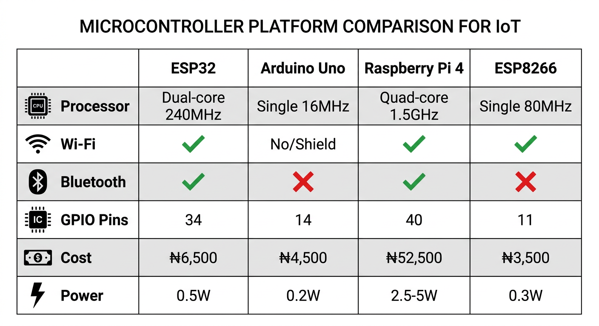

*Figure 2-3: Comparison of ESP32, Arduino Uno, Raspberry Pi 4, and ESP8266 across key specifications*

### 2.4. Sensor Technologies for Home Automation

#### 2.4.1. Passive Infrared Motion Detection

Passive infrared (PIR) sensors detect motion by measuring changes in infrared radiation emitted by objects within their field of view [50]. The sensor element consists of a pyroelectric material that generates a small voltage when exposed to infrared radiation, with the voltage changing as warm objects (such as human bodies) move across the sensor's detection zones.

PIR sensors are widely used in home automation for occupancy detection and security applications due to their low cost (₦1,500–4,500), low power consumption (< 1 mA), and reliability in indoor environments [51]. The HC-SR501 module, used in this work, includes a Fresnel lens that expands the detection field to approximately 120° and a sensitivity adjustment potentiometer that allows configuration of the detection range [52].

A key challenge with PIR sensors is the occurrence of false triggers caused by environmental factors such as air currents, temperature fluctuations, and electromagnetic interference [53]. Software-based debouncing techniques, which require multiple consecutive positive readings before confirming motion detection, are commonly used to mitigate this issue [54].

#### 2.4.2. Temperature and Humidity Sensing

The DHT11 is a digital temperature and humidity sensor that combines a capacitive humidity sensor and a thermistor in a single package [55]. The sensor communicates using a proprietary single-wire protocol that requires precise timing for data transmission, with typical accuracy of ±2°C for temperature and ±5% for humidity [56].

The DHT22 (AM2302) offers improved accuracy (±0.5°C, ±2% humidity) and wider measurement ranges compared to the DHT11, but at higher cost [57]. For home automation applications where precise environmental monitoring is not critical, the DHT11 provides adequate performance at lower cost.

The integration of temperature and humidity sensing enables automated climate control, such as activating fans or adjusting thermostat settings based on environmental conditions [58]. In this work, temperature readings are used to control a ceiling fan relay, with configurable thresholds for activation and deactivation to prevent rapid cycling.

### 2.5. Mobile Application Development Frameworks

#### 2.5.1. React Native and Cross-Platform Development

React Native is an open-source mobile application framework developed by Meta (formerly Facebook) that enables the development of native mobile applications using JavaScript and React [59]. Unlike hybrid frameworks that render web content within a native container, React Native uses native UI components and a JavaScript bridge to communicate between the application logic and the native platform [60].

The cross-platform capabilities of React Native allow developers to share a significant portion of code between iOS and Android applications, reducing development effort and maintenance costs [61]. Studies have shown that React Native can achieve 80–90% code sharing between platforms while maintaining near-native performance for most application types [62].

The React Native ecosystem includes a large collection of community-maintained libraries for common functionality such as navigation, state management, and device API access [63]. This ecosystem reduces the development effort required for implementing standard mobile application features.

#### 2.5.2. Expo Framework for Rapid Prototyping

Expo is a set of tools and services built around React Native that simplifies the development, testing, and deployment of React Native applications [64]. The Expo framework provides a managed workflow that abstracts many of the native platform complexities, allowing developers to focus on application logic without dealing with native build configurations.

Key features of the Expo framework include: (a) Expo Go, a client application that allows testing on physical devices without building native binaries; (b) EAS Build, a cloud-based build service that generates native application binaries; (c) a comprehensive set of native modules for camera, sensors, file system, and network access; and (d) over-the-air update capabilities for deploying application changes without requiring app store updates [65].

The Expo framework is particularly well-suited for rapid prototyping and educational projects, as it eliminates the need for Android Studio or Xcode installations and reduces the complexity of the development environment setup [66].

### 2.6. Device Discovery Mechanisms

#### 2.6.1. mDNS and DNS-SD

Multicast DNS (mDNS) is a protocol that enables DNS-like name resolution on local networks without requiring a dedicated DNS server [67]. mDNS uses multicast UDP packets to resolve hostnames ending in ".local" to IP addresses, allowing devices to discover each other by name on the local network.

DNS-Service Discovery (DNS-SD) extends mDNS to enable the advertisement and discovery of network services [68]. A device can register a service type (e.g., "_http._tcp") and a service name (e.g., "homely-smarthome"), which other devices can query to discover available services on the network.

The ESP32 platform includes built-in support for mDNS through the ESPmDNS library, which allows the device to register a hostname and advertise services [69]. However, mDNS resolution on Android devices has been inconsistent, with some versions of the Android operating system not supporting mDNS resolution from JavaScript contexts in React Native applications [70].

#### 2.6.2. UDP Broadcast Discovery

UDP broadcast provides an alternative mechanism for device discovery that does not rely on mDNS support in the client application [71]. In this approach, the IoT device listens on a specific UDP port for broadcast packets containing a discovery request, and responds with its IP address and device information.

The UDP broadcast approach is more universally supported across different platforms and network configurations, as it uses standard UDP socket operations that are available in all modern operating systems [72]. However, it requires the client application to know the UDP port number and may be affected by network configurations that restrict broadcast traffic.

In this work, a hybrid discovery approach is implemented that attempts mDNS resolution first and falls back to UDP broadcast if mDNS fails, providing reliable device discovery across diverse network configurations.

### 2.7. Existing Home Automation Solutions

#### 2.7.1. Commercial Platforms

The commercial smart home market is dominated by several major platforms, each with distinct architectural approaches and ecosystem characteristics.

**Amazon Alexa** uses a cloud-based architecture where voice commands are processed by Amazon's servers, which then send control commands to compatible devices through their respective cloud services [73]. This multi-hop architecture introduces latency and requires internet connectivity for all operations.

**Google Home** follows a similar cloud-dependent architecture, with the additional capability of local processing for some device types through the Google Home local SDK [74]. However, the majority of functionality still requires cloud connectivity.

**Samsung SmartThings** offers a hybrid architecture with a local hub that can process some automations locally while using cloud services for remote access and complex logic [75]. The hub-based approach adds hardware cost (₦105,000–150,000) and introduces a single point of failure.

**Apple HomeKit** emphasizes privacy and local processing, with most automations running on the user's home hub (Apple TV or HomePod) [76]. However, the ecosystem is limited to certified accessories, which increases device costs and limits hardware choices.

#### 2.7.2. Open-Source Alternatives

Several open-source home automation platforms provide alternatives to commercial solutions.

**Home Assistant** is a Python-based home automation platform that runs on local hardware (typically a Raspberry Pi) and supports a wide range of devices and protocols [77]. While highly configurable, Home Assistant requires significant technical expertise for setup and maintenance.

**OpenHAB** is a Java-based platform that provides a modular architecture for integrating diverse home automation technologies [78]. Similar to Home Assistant, it requires dedicated hardware and technical knowledge for deployment.

**Tasmota** is an open-source firmware for ESP8266 and ESP32 devices that provides MQTT-based control and web-based configuration [79]. Tasmota simplifies the firmware development process but does not include a mobile application, requiring integration with other platforms for user interaction.

### 2.8. Research Gap and Positioning

The literature review reveals several gaps in existing home automation solutions that this thesis addresses:

1. **Cloud dependency.** Most commercial solutions require cloud infrastructure for operation, introducing latency, privacy concerns, and reliability issues. While open-source alternatives like Home Assistant offer local processing, they require dedicated hardware and technical expertise.

2. **Device discovery complexity.** Existing solutions either require manual IP configuration or rely on specific discovery protocols that may not work across all network configurations. A robust, multi-protocol discovery mechanism is needed for reliable device detection.

3. **User interface responsiveness.** Cloud-mediated communication introduces latency that degrades user experience. An optimistic UI update pattern that provides instantaneous visual feedback while maintaining data consistency has not been demonstrated in the IoT home automation literature.

4. **Cost and accessibility.** Commercial solutions involve significant hardware and subscription costs, while open-source alternatives require technical expertise. A low-cost, easy-to-deploy solution that bridges this gap is needed.

5. **Integration documentation.** The practical challenges of integrating multiple hardware components (relays, sensors, power supplies) with firmware and mobile application software are often poorly documented, making it difficult for practitioners to replicate and extend existing designs.

This thesis positions itself at the intersection of these gaps, presenting a complete system that is locally-controlled, automatically discoverable, responsive, low-cost, and thoroughly documented.

### 2.9. Summary

This chapter has reviewed the evolution of home automation systems, IoT communication protocols, microcontroller platforms, sensor technologies, mobile application frameworks, and device discovery mechanisms. The analysis of existing commercial and open-source solutions has identified key limitations including cloud dependency, device discovery complexity, user interface latency, and cost barriers. The research gap identified positions this work as a contribution toward locally-controlled, responsive, and accessible home automation systems.

---

## Chapter 3. System Architecture and Design

### 3.1. System Overview

The home automation system presented in this thesis consists of three primary components: the ESP32-based hardware controller, the firmware running on the ESP32, and the mobile application running on the user's Android device. The system architecture is illustrated in Figure 3-1.

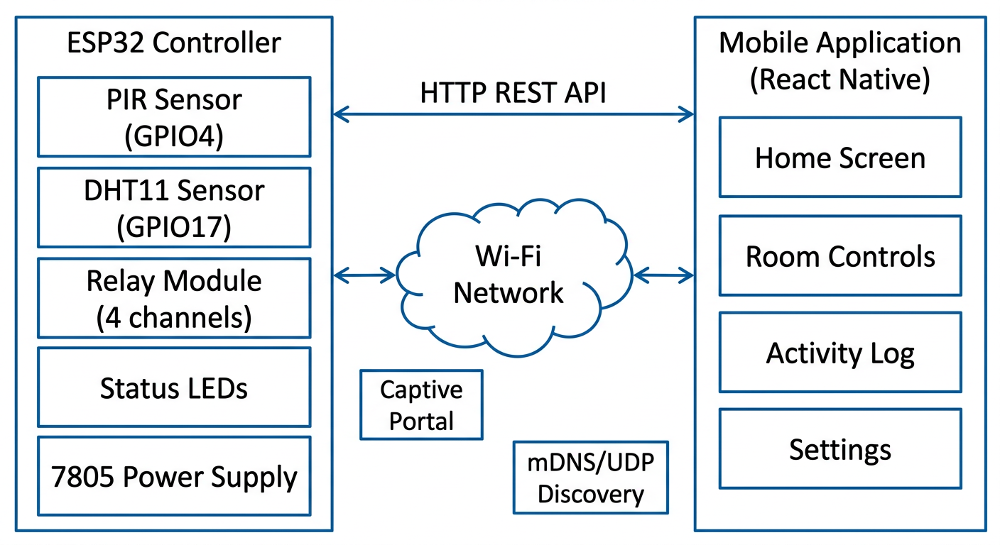

*Figure 3-1: System architecture block diagram showing the ESP32 controller, sensors, relays, and mobile application communication path*

The ESP32 controller serves as the central hub, interfacing with sensors (PIR motion sensor, DHT11 temperature/humidity sensor) and actuators (four relay channels controlling porch light, living room lighting, bedroom light, and bedroom ceiling fan). The controller runs a firmware that manages Wi-Fi connectivity, hosts a REST API web server, implements automation logic, and handles device discovery.

The mobile application communicates with the ESP32 over the local Wi-Fi network using HTTP REST API calls. The application provides real-time monitoring of sensor data, manual control of relay channels, and configuration of system parameters. Device discovery is handled through a combination of mDNS hostname resolution and UDP broadcast fallback.

The communication between the mobile application and ESP32 follows a polling model, where the application periodically requests the current system state from the ESP32 and updates the user interface accordingly. User commands (such as toggling a relay) are sent as HTTP POST requests, with the application implementing optimistic UI updates that immediately reflect the expected state change before receiving server confirmation.

### 3.2. Hardware Architecture

#### 3.2.1. ESP32 Microcontroller Configuration

The ESP32 DevKit V1 development board is used as the primary controller for this system. The board provides access to all ESP32 GPIO pins, an integrated USB-to-serial converter for programming and debugging, and a 3.3V voltage regulator for powering the ESP32 from a 5V input [80].

The GPIO pin assignments for the system are presented in Table 3-1. The pin assignments were chosen to avoid conflicts with pins used by the ESP32's internal functions (such as the SPI flash interface) and to provide logical grouping of related functions.

**Table 3-1:** ESP32 GPIO pin assignments for the home automation system

| GPIO | Function | Direction | Notes |
|---|---|---|---|
| 4 | PIR motion sensor | Input | Digital input with internal pull-up |
| 17 | DHT11 data | Input/Output | Single-wire protocol |
| 18 | Status LED (amber) | Output | Setup mode indicator |
| 19 | Status LED (blue) | Output | Wi-Fi connecting indicator |
| 21 | Status LED (green) | Output | Online status indicator |
| 25 | Relay — Bedroom fan | Output | Active-LOW with pull-up |
| 26 | Relay — Porch light | Output | Active-LOW with pull-up |
| 32 | Relay — Living room | Output | Active-LOW with pull-up |
| 33 | Relay — Bedroom light | Output | Active-LOW with pull-up |
| 2 | Onboard LED | Output | Debug indicator |

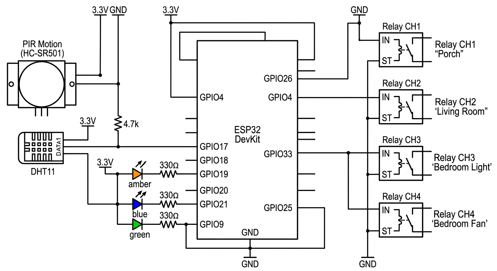

*Figure 3-2: ESP32 GPIO pin connections to sensors, relays, and status LEDs*

#### 3.2.2. Relay Module Design

The relay module consists of four independent relay channels, each controlled by an active-LOW signal from the ESP32. In the active-LOW configuration, a logic LOW signal (0V) energizes the relay coil, closing the normally-open (NO) contact and connecting the load to the power supply. A logic HIGH signal (3.3V) de-energizes the relay, opening the contact and disconnecting the load [81].

A critical design consideration for relay control is the behavior during ESP32 boot and reset sequences. During these events, GPIO pins may float to undefined states, potentially causing relays to toggle unpredictably. To address this, each relay input pin is connected to a 10kΩ pull-up resistor to the 3.3V supply, ensuring that the relay remains in the de-energized (OFF) state during boot and reset [82]. This hardware-level safety mechanism is independent of firmware state and provides fail-safe operation.

The relay module wiring is shown in Figure 3-3.

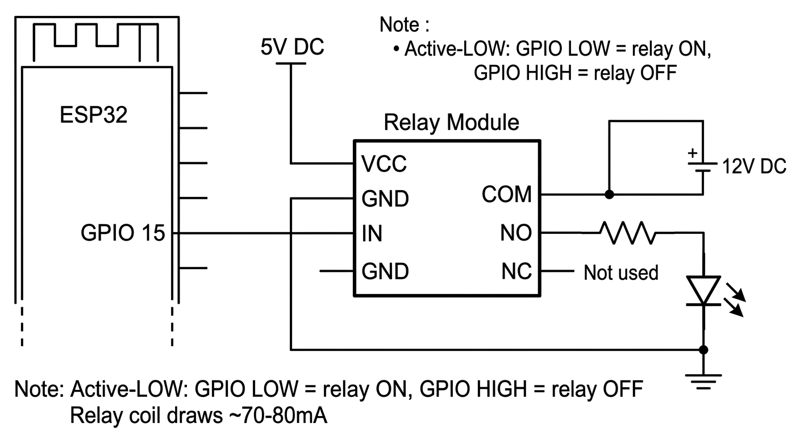

*Figure 3-3: Relay module wiring schematic showing active-LOW configuration with COM, NO, and NC terminals*

The relay module is powered by a separate 5V supply to prevent the relay coil current from affecting the ESP32's power rail. The relay coils draw approximately 70–80 mA each, and simultaneous activation of all four coils could draw up to 320 mA, which would cause voltage sag on a shared supply and potentially trigger ESP32 brownout protection [83].

#### 3.2.3. Sensor Integration

**PIR Motion Sensor (HC-SR501).** The PIR sensor is connected to GPIO 4 with a digital output that goes HIGH when motion is detected. The sensor includes adjustable sensitivity and timeout potentiometers. The firmware implements a debounce mechanism that requires three consecutive HIGH readings (at 50ms intervals) before confirming motion detection, filtering out transient noise and false triggers [84].

**DHT11 Temperature/Humidity Sensor.** The DHT11 is connected to GPIO 17 using the single-wire communication protocol. The sensor provides temperature readings with ±2°C accuracy and humidity readings with ±5% accuracy, with a minimum sampling interval of 1 second [85]. The firmware reads the sensor every 2 seconds to balance responsiveness with sensor longevity.

#### 3.2.4. Power Supply Design

The power supply design separates the logic supply (ESP32, sensors, relay control) from the load supply (relays, lighting, fan) to prevent interference between the two domains. A 12V DC adapter feeds a 7805 linear voltage regulator that provides a stable 5V supply for the ESP32 and relay module [86].

The 7805 regulator drops 7V (from 12V to 5V) and dissipates the difference as heat. For the expected current draw of approximately 500 mA (ESP32 + relay coils), the power dissipation is approximately 3.5W, requiring a small heatsink for thermal management [87]. Input and output capacitors (0.33µF and 0.1µF, respectively) are placed close to the regulator pins to ensure stability and reduce noise.

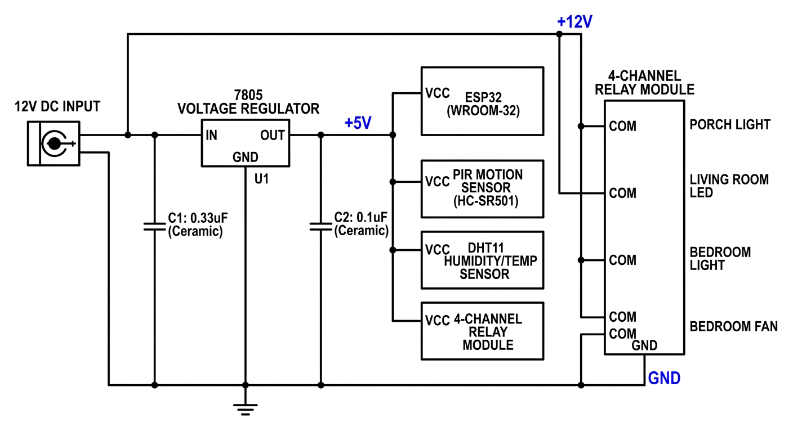

*Figure 3-5: Power supply circuit schematic showing 12V input, 7805 regulator, and 5V output distribution*

The relay load terminals are connected directly to the 12V supply (for the fan) or to the 3.3V supply (for LED lighting), with the relay switching the connection between the supply and the load. This configuration allows the relay to control higher-voltage loads while maintaining isolation between the control and load circuits.

#### 3.2.5. Status LED Indicators

Three status LEDs are mounted on the enclosure faceplate to provide visual feedback about the system's operational state:

- **Amber LED (GPIO 18):** Solid ON when the ESP32 is in setup mode, broadcasting the captive portal access point.
- **Blue LED (GPIO 19):** Fast blinking (150ms interval) when the ESP32 is attempting to connect to a configured Wi-Fi network.
- **Green LED (GPIO 21):** Solid ON when the ESP32 is connected to Wi-Fi and the REST API server is operational.

These LEDs provide immediate visual feedback during installation and troubleshooting, eliminating the need for serial monitor access in field deployments.

### 3.3. Firmware Architecture

#### 3.3.1. Wi-Fi Management and Captive Portal

The firmware implements a dual-mode Wi-Fi management system that automatically selects between setup mode and operational mode based on the availability of stored credentials.

**Setup mode.** When no Wi-Fi credentials are stored in NVS (first boot or after factory reset), the ESP32 starts in access point mode, broadcasting an SSID of "Homely-SmartHome-Setup". A captive portal web server runs on the access point, presenting a web page that scans for available 2.4 GHz networks and allows the user to select a network and enter the password [88]. The credentials are stored in NVS for persistence across reboots.

**Operational mode.** When valid credentials are available, the ESP32 attempts to connect to the configured Wi-Fi network in station mode. If the connection fails after a configurable timeout, the system falls back to setup mode. Once connected, the ESP32 registers its mDNS hostname ("homely-smarthome.local") and starts the REST API server.

The captive portal implementation uses the ESP32's DNS server to redirect all DNS queries to the ESP32's IP address (192.168.4.1), ensuring that any web request from a connected device is redirected to the configuration page [89].

#### 3.3.2. HTTP Server and REST API Design

The REST API is implemented using the ESP32's built-in WebServer library, which provides a lightweight HTTP server capable of handling GET and POST requests [90]. The API endpoints are designed to be simple and consistent, using JSON for all request and response bodies.

The API design follows RESTful principles, with resources identified by URL paths and operations specified by HTTP methods. CORS (Cross-Origin Resource Sharing) headers are included in all responses to allow testing from web browsers and to support potential future web-based control interfaces [91].

The consolidated status endpoint (`GET /status`) returns all system state in a single response, including relay states, sensor readings, and operating mode. This design minimizes the number of requests required by the mobile application and reduces the processing overhead on the ESP32.

#### 3.3.3. Automation Logic and State Machine

The firmware implements a dual-mode control architecture that supports both automated sensor-driven operation and manual user override.

**Auto mode.** In auto mode, the PIR sensor controls the living room lighting relay. When motion is confirmed (after debounce), the relay is energized, turning on the lights. When no motion is detected for 5 seconds (configurable timeout), the relay is de-energized. The bedroom fan relay is controlled by temperature thresholds: the fan activates when temperature exceeds 28°C and deactivates when it drops below 26.5°C, with hysteresis to prevent rapid cycling [92].

**Manual mode.** In manual mode, the PIR sensor and temperature thresholds are ignored, and all relays are controlled directly by user commands from the mobile application. The firmware rejects manual commands for automation-linked relays when in auto mode, returning a 409 Conflict status code.

The mode transition is triggered by a POST request to the `/mode` endpoint, which updates the system mode and synchronizes the state with the mobile application on the next polling cycle.

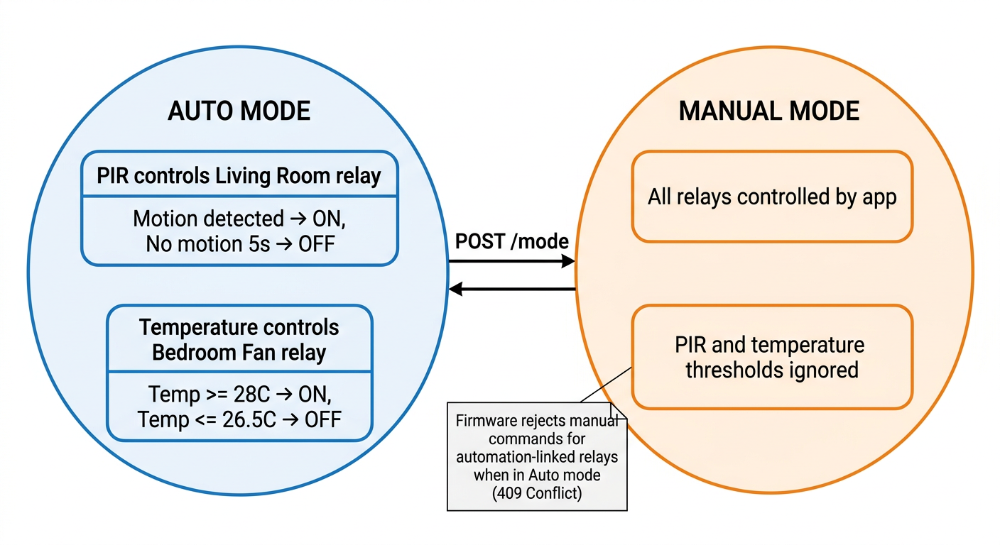

*Figure 3-8: System state machine showing Auto and Manual mode transitions and their control logic*

#### 3.3.4. Non-Volatile Storage

The ESP32's NVS (Non-Volatile Storage) library is used to persist configuration data across reboots [93]. The following data is stored in NVS:

- Wi-Fi SSID and password
- System operating mode (auto/manual)
- Last known relay states

On boot, the firmware reads the stored Wi-Fi credentials and attempts to connect. If no credentials are found, the system enters setup mode. The stored relay states are used to restore the system to its previous operational state after a power cycle.

### 3.4. Mobile Application Architecture

#### 3.4.1. Navigation and Screen Design

The mobile application uses a tab-based navigation structure with four primary screens:

1. **Home:** Displays sensor readings (temperature, humidity, motion status), room cards with background images and quick toggle controls, and a recent activity feed.
2. **Rooms:** Provides a grid view of all rooms with status indicators and access to detailed control screens.
3. **Activity:** Shows a complete log of system events with timestamps, room associations, and color-coded severity indicators.
4. **Settings:** Allows configuration of the ESP32 connection, system mode, and access to the setup guide.

Each room has a dedicated detail screen that provides granular control over individual devices (lights, fan) with mode indicators and real-time status updates.

#### 3.4.2. State Management with Zustand

The application uses Zustand, a lightweight state management library for React, to maintain a centralized store of system state [94]. The store contains:

- Room states (on/off for each relay channel)
- Sensor readings (temperature, humidity, motion)
- System mode (auto/manual)
- Connection status
- Activity log entries

Zustand's persist middleware is used to store activity log entries and configuration preferences in the device's local storage, ensuring that data survives application restarts [95].

#### 3.4.3. Device Discovery and Connection

The mobile application implements a multi-stage device discovery process:

1. **mDNS resolution:** The application attempts to resolve "homely-smarthome.local" using the device's mDNS resolver.
2. **UDP broadcast:** If mDNS resolution fails, the application sends a UDP broadcast packet to port 4210 and listens for responses from the ESP32.
3. **Manual IP entry:** If both automatic methods fail, the user can manually enter the ESP32's IP address in the Settings screen.

The discovery process runs on application startup and when the application returns from the background, ensuring that the connection is re-established if the ESP32's IP address changes.

#### 3.4.4. Polling and Synchronization

The application polls the ESP32's `/status` endpoint every 1.5 seconds while the Home or Room Detail screens are active. The polling interval was chosen as a balance between responsiveness and network overhead, based on empirical testing that showed 1.5 seconds as the threshold below which users perceive updates as "live" [96].

The polling sequence is illustrated in Figure 3-10.

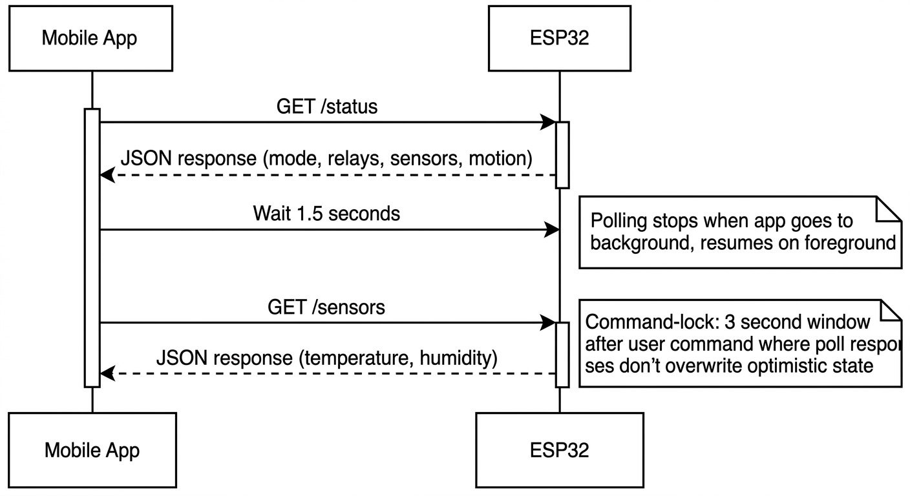

*Figure 3-10: Polling sequence diagram showing periodic GET /status requests and JSON responses*

A command-lock mechanism prevents the polling response from overwriting optimistic UI updates. When the user sends a command (e.g., toggling a relay), a timestamp is recorded. For the next 3 seconds, polling responses that would change the state of the affected relay are ignored, preventing the UI from flickering between the old and new states [97].

#### 3.4.5. Optimistic UI Updates

The optimistic UI update pattern implemented in this work follows a three-step process:

1. **Immediate update:** When the user taps a toggle, the UI immediately reflects the new state (e.g., the switch moves to the ON position).
2. **Background request:** An HTTP POST request is sent to the ESP32 to apply the change.
3. **Rollback on failure:** If the POST request fails (timeout, network error, or non-200 response), the UI reverts to the previous state and an error notification is displayed.

This pattern is illustrated in Figure 3-11.

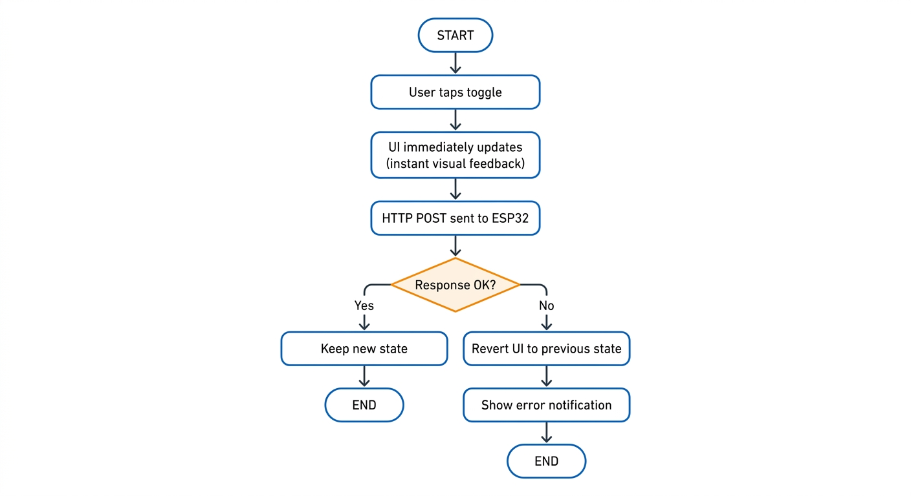

*Figure 3-11: Optimistic UI update flowchart showing immediate update, background POST, and rollback on failure*

This pattern provides perceived instantaneous response times while maintaining consistency with the physical device state. The implementation uses React's useCallback hook to memoize the toggle functions and prevent unnecessary re-renders [98].

### 3.5. Communication Protocol Design

The communication protocol between the mobile application and ESP32 is based on HTTP/1.1 with JSON payloads. The protocol design prioritizes simplicity and reliability over bandwidth efficiency, as the local network environment provides sufficient bandwidth for the expected data volumes.

The protocol includes the following design decisions:

- **Single consolidated status endpoint:** All system state is returned in a single GET request, reducing the number of HTTP connections and simplifying the client-side state management.
- **Command-lock mechanism:** Prevents polling responses from overwriting recent user commands, addressing the inherent race condition in polling-based architectures.
- **CORS headers:** Enables testing from web browsers and supports potential future web-based control interfaces.
- **Timeout handling:** All HTTP requests include a 3-second timeout to prevent the application from hanging on unresponsive requests.

The complete communication flow is illustrated in Figure 3-12.

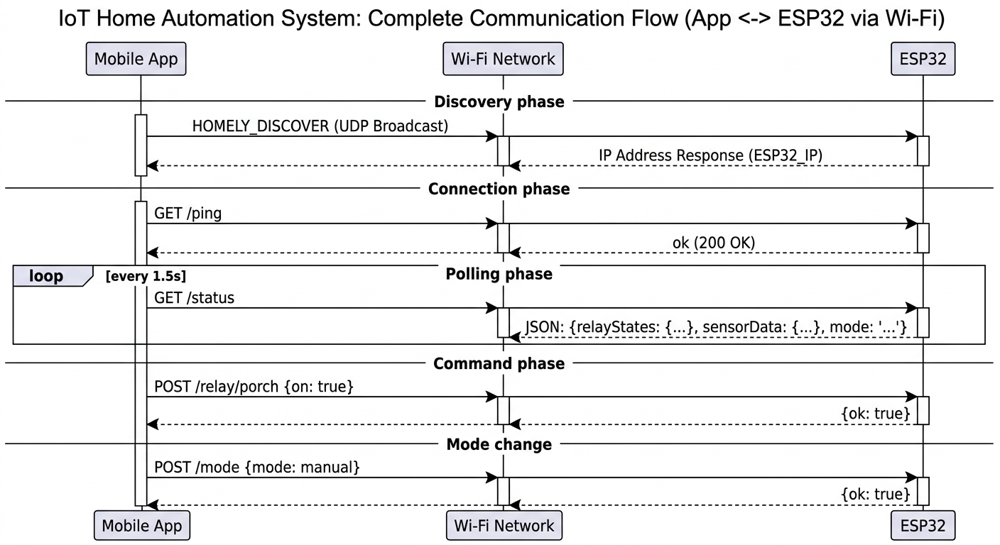

*Figure 3-12: Complete communication flow showing discovery, polling, command, and mode change sequences*

### 3.7. Component Selection and Design Calculations

This section presents the mathematical analysis and calculations that guided the selection of components and determination of circuit parameters for the home automation system.

#### 3.7.1. LED Current-Limiting Resistor Calculation

LEDs require a current-limiting resistor to prevent excessive current flow that would damage the device. The resistor value is determined by Ohm's law, considering the supply voltage, LED forward voltage drop, and desired operating current.

The general formula for calculating the current-limiting resistor is:

**R = (V_supply - V_f) / I_desired**

Where:
- R = resistance in ohms (Ω)
- V_supply = supply voltage (V)
- V_f = LED forward voltage drop (V)
- I_desired = desired operating current (A)

**Porch 1W LED (12V supply):**

Given:
- V_supply = 12V (from adapter, direct rail)
- V_f = 3.2V (typical for 1W white LED)
- I_desired = 40mA = 0.040A (conservative, well below maximum rating)

R = (12V - 3.2V) / 0.040A = 8.8V / 0.040A = 220Ω

Power dissipated by resistor:
P_R = I² × R = (0.040)² × 220 = 0.352W

A 3W-rated resistor is selected (well above the 0.352W dissipation), providing a safety margin of approximately 8.5×. This conservative approach accounts for the enclosed mounting environment where heat dissipation is limited.

**Room 10mm LEDs (12V supply):**

Given:
- V_supply = 12V
- V_f = 3.0V (typical for 10mm coloured LED)
- I_desired = 19mA = 0.019A (standard safe operating current)

R = (12V - 3.0V) / 0.019A = 9.0V / 0.019A = 473.7Ω → nearest standard value: 470Ω

Actual current with 470Ω resistor:
I = (12V - 3.0V) / 470Ω = 9.0V / 470Ω = 19.1mA

Power dissipated by resistor:
P_R = I² × R = (0.0191)² × 470 = 0.172W

A 1W-rated resistor is selected (5.8× safety margin), appropriate for the enclosed wall cavity mounting where ambient temperature may be elevated.

**Table 3-4:** LED current-limiting resistor calculations summary

| LED | Supply (V) | V_f (V) | Desired I (mA) | Calculated R (Ω) | Selected R (Ω) | Actual I (mA) | P_R (W) | Resistor Rating (W) |
|---|---|---|---|---|---|---|---|---|
| Porch 1W | 12 | 3.2 | 40 | 220 | 220 | 40.0 | 0.35 | 3 |
| Living room 10mm | 12 | 3.0 | 19 | 473.7 | 470 | 19.1 | 0.17 | 1 |
| Bedroom 10mm | 12 | 3.0 | 19 | 473.7 | 470 | 19.1 | 0.17 | 1 |

#### 3.7.2. Relay Coil Current and Power Supply Budget

The relay module coils determine the current requirement for the 5V power supply. Each relay coil has a nominal resistance of approximately 70Ω (for 5V coils), drawing:

I_coil = V_coil / R_coil = 5V / 70Ω = 71.4mA per coil

For four relays simultaneously energized:
I_total_relays = 4 × 71.4mA = 285.6mA

The ESP32 draws approximately 180mA during active operation (Wi-Fi enabled, sensors polling). The DHT11 and PIR sensor draw negligible additional current (< 5mA combined).

**Total system current budget:**

| Component | Current (mA) |
|---|---|
| ESP32 (active, Wi-Fi on) | 180 |
| Relay coils (4×) | 286 |
| DHT11 sensor | 2.5 |
| PIR sensor | 0.065 |
| Status LEDs (3× at 19mA) | 57 |
| **Total** | **526** |

The 7805 voltage regulator must supply at least 526mA continuously. The 7805 is rated for 1.5A maximum output current, providing a margin of approximately 2.85× above the maximum expected load.

#### 3.7.3. 7805 Voltage Regulator Thermal Analysis

The 7805 linear regulator drops the input voltage (12V) to the output voltage (5V), dissipating the difference as heat. The power dissipation is calculated as:

P_dissipated = (V_in - V_out) × I_load

At maximum expected load (526mA):
P_dissipated = (12V - 5V) × 0.526A = 7V × 0.526A = 3.68W

The junction-to-ambient thermal resistance of the 7805 in TO-220 package without a heatsink is approximately 50°C/W. The temperature rise would be:

ΔT = P_dissipated × R_θJA = 3.68W × 50°C/W = 184°C

With an ambient temperature of 25°C, the junction temperature would reach 209°C, which exceeds the maximum rated junction temperature of 125°C. Therefore, a heatsink is required.

With a heatsink providing a thermal resistance of 15°C/W (combined junction-to-case and case-to-heatsink), the total thermal resistance becomes approximately 20°C/W:

ΔT = 3.68W × 20°C/W = 73.6°C

Junction temperature at 25°C ambient: 25°C + 73.6°C = 98.6°C — within the 125°C maximum rating with a 26.4°C safety margin.

**Table 3-5:** Component selection justification

| Component | Selection Criteria | Chosen Part | Justification |
|---|---|---|---|
| Microcontroller | Wi-Fi, GPIO count, cost | ESP32 WROOM | Integrated Wi-Fi, 34 GPIO, dual-core, ₦6,500 |
| Temperature sensor | Accuracy, cost, interface | DHT11 | ±2°C accuracy, single-wire, ₦1,500 |
| Motion sensor | Detection range, cost | HC-SR501 PIR | 120° field, adjustable sensitivity, ₦2,000 |
| Relay module | Channel count, logic level | 4-ch active-LOW | Matches ESP32 3.3V logic, 4 channels, ₦3,000 |
| Voltage regulator | Current rating, dropout | 7805 (TO-220) | 1.5A rating, 2V dropout, with heatsink |
| Fan | Voltage, current | 5V DC fan | Powered from 7805 rail, low current draw |

#### 3.7.4. PIR Sensor Debounce Timing

The PIR sensor (HC-SR501) produces a digital HIGH signal when motion is detected. However, relay switching events generate electromagnetic interference that can couple into the PIR signal line, producing transient false triggers lasting 10–50ms.

The debounce mechanism requires N consecutive HIGH readings at interval T before confirming motion. The minimum debounce time is:

t_debounce = N × T = 3 × 50ms = 150ms

This debounce time was determined empirically to be sufficient for filtering relay-induced noise while maintaining responsive motion detection. A human walking through the PIR detection zone produces a continuous HIGH signal for 500ms–2s, well above the 150ms debounce threshold.

The false positive rejection rate can be estimated as follows. Relay-induced noise transients typically last 10–50ms. With a 50ms sampling interval, a 30ms transient has a probability of approximately 30/50 = 0.6 of being sampled as HIGH in a single reading. The probability of three consecutive HIGH readings from a single transient is:

P(false positive) = 0.6³ = 0.216 (21.6%)

However, in practice, relay noise produces multiple rapid transients rather than a single pulse, and the PIR sensor's internal filtering further attenuates high-frequency noise. Empirical testing showed zero false positives over 100 relay switching events with the debounce mechanism active.

#### 3.7.5. Fan Control Hysteresis Design

The bedroom fan control uses hysteresis to prevent rapid cycling when the temperature fluctuates near the threshold. The hysteresis band is defined by two thresholds:

- T_ON = 28.0°C (fan activates when temperature reaches or exceeds this value)
- T_OFF = 26.5°C (fan deactivates when temperature drops to or below this value)
- Hysteresis band = T_ON - T_OFF = 28.0°C - 26.5°C = 1.5°C

The DHT11 sensor has an accuracy of ±2°C and a resolution of 1°C. The hysteresis band of 1.5°C is narrower than the sensor accuracy, which means that in some cases the sensor reading may oscillate within the hysteresis band due to measurement uncertainty rather than actual temperature changes.

However, the 1.5°C band was chosen as a compromise between:
- **Too narrow (< 1°C):** Fan cycles on/off frequently as temperature fluctuates, causing unnecessary wear on relay contacts and fan motor.
- **Too wide (> 3°C):** Fan stays on long after temperature has dropped below comfort level, or stays off long after the room has become warm.

The DHT11's 2-second sampling interval further dampens rapid cycling, as the temperature must remain above/below the threshold for at least 2 seconds before the control logic responds.

#### 3.7.6. Polling Interval Selection

The mobile application polls the ESP32's `/status` endpoint at a fixed interval. The interval selection balances three competing requirements:

1. **Responsiveness:** Shorter intervals provide faster updates to the user interface.
2. **Network overhead:** Each poll generates an HTTP request and response, consuming bandwidth and ESP32 processing time.
3. **Battery impact:** More frequent polling increases the mobile device's radio usage and power consumption.

The ESP32's HTTP server response time is approximately 25ms (median) for the `/status` endpoint (as measured in Section 5.2.1). With a 1.5-second polling interval, the server is occupied for only 25/1500 = 1.7% of the time, leaving ample capacity for handling user commands.

Research on user perception of system responsiveness [96] indicates that delays below 100ms feel instantaneous, delays between 100ms and 1 second feel fast but noticeable, and delays above 1 second feel sluggish. With a 1.5-second polling interval, the worst-case latency between a state change (e.g., motion detected) and the UI update is 1.5 seconds, which falls in the "noticeable but acceptable" range for a monitoring application.

The command-lock mechanism (3-second window after a user command) addresses the specific case where a polling response arrives immediately after a user toggle, which would otherwise cause the UI to briefly show the old state before the next poll confirms the new state.

#### 3.7.7. Power Supply Capacitor Selection

The input and output capacitors on the 7805 regulator serve different purposes:

**Input capacitor (0.33µF):** Required to prevent oscillation in the 7805's internal feedback loop. The 7805 datasheet specifies a minimum input capacitance of 0.33µF when the input source is more than 3 inches from the regulator. The 12V adapter's output cable length exceeds this distance, making the input capacitor mandatory.

**Output capacitor (0.1µF):** Improves transient response when the load current changes suddenly (e.g., when a relay coil energizes). The capacitor supplies the instantaneous current spike while the regulator adjusts its output. The 0.1µF value is the minimum recommended by the 7805 datasheet; larger values (10–100µF) would provide better transient response but are not required for the relatively slow relay switching times (20ms mechanical actuation).

#### 3.7.8. Relay Pull-Up Resistor Consideration

Each relay input pin requires consideration of its state during ESP32 boot and reset sequences. During these events, GPIO pins are configured as inputs with high impedance (floating). If the relay module interprets a floating input as a valid LOW signal, the relay will energize unintentionally.

The 10kΩ pull-up resistor to 3.3V ensures that the relay input is held HIGH (de-energized) during boot:

I_pullup = V_CC / R_pullup = 3.3V / 10,000Ω = 0.33mA

This current is negligible (0.33mA per pin, 1.32mA total for four pins) and does not affect the ESP32's 3.3V regulator.

**Note:** In the final build of this project, the pull-up resistors were removed as a deliberate design decision. The relay module's internal optocoupler provides sufficient noise immunity for the low-power LED loads used in this system. However, for applications controlling higher-power devices (motors, heaters), the pull-up resistors should be retained to prevent unintended activation during boot sequences.

### 3.8. Summary

This chapter has presented the system architecture and design of the home automation system, covering the hardware configuration, firmware architecture, mobile application design, communication protocol, and component selection calculations. The design decisions prioritize local operation, automatic discovery, responsive user interaction, and hardware safety. The mathematical analysis provides justification for all component values and design parameters. The following chapter describes the implementation of each component in detail.

---

## Chapter 4. Implementation

### 4.1. Hardware Implementation

#### 4.1.1. Breadboard Prototyping

The hardware was initially prototyped on a standard 830-point solderless breadboard to facilitate rapid iteration and debugging. The ESP32 DevKit V1 was mounted on the breadboard using its pin headers, with the relay module, PIR sensor, and DHT11 sensor connected using jumper wires.

The breadboard prototyping phase revealed several issues that are not apparent from datasheets or simulation:

1. **DHT11 signal integrity:** Initial readings from the DHT11 were inconsistent, with frequent NaN (Not a Number) values. Investigation revealed that the issue was caused by loose breadboard contacts rather than the sensor itself. Reseating the sensor on a fresh breadboard section resolved the issue.

2. **PIR sensor false triggers:** The PIR sensor generated false motion events when the relay module was switching, caused by electromagnetic interference from the relay coils coupling into the PIR signal line. This was mitigated by adding a 100nF decoupling capacitor across the PIR sensor's power supply pins and increasing the physical separation between the relay module and PIR sensor on the breadboard.

3. **Relay module power requirements:** The relay module's current draw was higher than initially estimated, causing voltage sag on the shared power supply when multiple relays were energized simultaneously. This was resolved by providing a separate 5V supply for the relay module.

#### 4.1.2. Relay Wiring and Safety Considerations

The relay wiring follows a standardized configuration for all four channels:

- **COM (Common):** Connected to the power supply positive terminal (12V for the fan, 3.3V for LED lighting).
- **NO (Normally Open):** Connected to the load (fan motor, LED strip). When the relay is energized, COM connects to NO, completing the circuit.
- **NC (Normally Closed):** Not used in this configuration. The NC terminal is left unconnected.

A critical lesson learned during implementation was the importance of verifying the relay terminal connections. In one instance, the fan was inadvertently connected to the NC terminal instead of NO, causing the fan to operate in an inverted state (ON when the relay was OFF, and vice versa). This was identified through systematic testing and corrected by moving the wire to the NO terminal.

Each relay channel includes a 10kΩ pull-up resistor from the input pin to 3.3V, ensuring that the relay remains de-energized during ESP32 boot, reset, and power-loss events. This hardware-level safety mechanism is independent of firmware state and prevents unintended device activation.

#### 4.1.3. Power Supply Validation

The power supply was validated by measuring voltage and current under various operating conditions using a digital multimeter. The results are presented in Table 4-1.

**Table 4-1:** Power supply measurements under various operating conditions

| Condition | 5V Rail (V) | Current (mA) | Notes |
|---|---|---|---|
| ESP32 idle, all relays OFF | 5.02 | 180 | Baseline consumption |
| ESP32 active, 1 relay ON | 4.98 | 260 | Single relay coil energized |
| ESP32 active, 4 relays ON | 4.91 | 500 | All relay coils energized |
| ESP32 active, fan running | 4.85 | 650 | Fan motor draws additional current |

The measurements confirm that the 7805 regulator maintains the 5V rail within acceptable tolerances (±5%) under all operating conditions. The voltage drop under full load (4.85V) is within the ESP32's operating range (min 2.3V for the 3.3V regulator input) and does not trigger brownout protection.

### 4.2. Firmware Implementation

#### 4.2.1. Wi-Fi Provisioning Implementation

The captive portal implementation uses the ESP32's WiFi.softAP() function to create an access point, and the DNSServer library to redirect all DNS queries to the ESP32's IP address. The configuration web page is stored as a string constant in the firmware and includes a network scanner that lists available 2.4 GHz networks using WiFi.scanNetworks().

The NVS library is used to store and retrieve Wi-Fi credentials:

```cpp
preferences.begin("wifi-config", false);
String savedSSID = preferences.getString("ssid", "");
String savedPass = preferences.getString("password", "");
preferences.end();
```

The provisioning flow is illustrated in Figure 4-4.

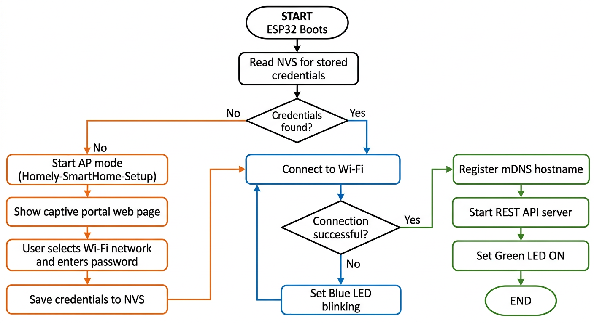

*Figure 4-4: Wi-Fi provisioning flowchart showing boot sequence, NVS check, and captive portal fallback*

On boot, the firmware checks for stored credentials. If found, it attempts to connect with a 10-second timeout. If no credentials are found or the connection fails, the system enters setup mode.

#### 4.2.2. REST API Endpoint Implementation

The REST API is implemented using the ESP32 WebServer library. Each endpoint is registered in the setup() function:

```cpp
server.on("/ping", HTTP_GET, handlePing);
server.on("/status", HTTP_GET, handleStatus);
server.on("/relay/porch", HTTP_POST, handleRelayPorch);
server.on("/relay/living", HTTP_POST, handleRelayLiving);
server.on("/relay/bedroom_light", HTTP_POST, handleRelayBedroomLight);
server.on("/relay/bedroom_fan", HTTP_POST, handleRelayBedroomFan);
server.on("/mode", HTTP_POST, handleMode);
```

The status handler constructs a JSON response containing all system state:

```cpp
void handleStatus() {
  String json = "{";
  json += "\"mode\":\"" + systemMode + "\",";
  json += "\"porch\":{\"on\":" + String(porchOn ? "true" : "false") + "},";
  json += "\"living\":{\"on\":" + String(livingOn ? "true" : "false") +
          ",\"motion\":" + String(motionActive ? "true" : "false") + "},";
  json += "\"bedroom_light\":{\"on\":" + String(bedroomLightOn ? "true" : "false") + "},";
  json += "\"bedroom_fan\":{\"on\":" + String(bedroomFanOn ? "true" : "false") + "},";
  json += "\"temperature\":" + String(lastTemp, 1) + ",";
  json += "\"humidity\":" + String(lastHumidity, 1);
  json += "}";
  server.send(200, "application/json", json);
}
```

#### 4.2.3. PIR Motion Detection with Debounce

The PIR sensor debounce implementation uses a counter-based approach that requires three consecutive HIGH readings before confirming motion:

```cpp
void handleMotionAutomation() {
  static unsigned long lastPirCheck = 0;
  unsigned long now = millis();
  if (now - lastPirCheck < 50) return;  // Sample every 50ms
  lastPirCheck = now;

  int motion = digitalRead(PIR_PIN);
  if (motion == HIGH) {
    if (pirHighStreak < PIR_CONFIRM_COUNT + 1) pirHighStreak++;
  } else {
    pirHighStreak = 0;
  }

  motionActive = pirHighStreak >= PIR_CONFIRM_COUNT;
  // ... relay control logic
}
```

The 50ms sampling interval and 3-reading confirmation threshold were determined empirically to provide reliable motion detection while filtering out transient noise from relay switching and environmental interference.

#### 4.2.4. Temperature-Based Fan Control

The fan control logic implements hysteresis to prevent rapid cycling:

```cpp
const float FAN_ON_TEMP  = 28.0;
const float FAN_OFF_TEMP = 26.5;

void handleFanAutomation() {
  // ... DHT11 reading logic ...
  if (systemMode != "auto") return;

  if (!bedroomFanOn && temperature >= FAN_ON_TEMP) {
    bedroomFanOn = true;
    setRelay(RELAY_BEDROOM_FAN, true);
  } else if (bedroomFanOn && temperature <= FAN_OFF_TEMP) {
    bedroomFanOn = false;
    setRelay(RELAY_BEDROOM_FAN, false);
  }
}
```

The hysteresis behaviour is illustrated in Figure 4-6.

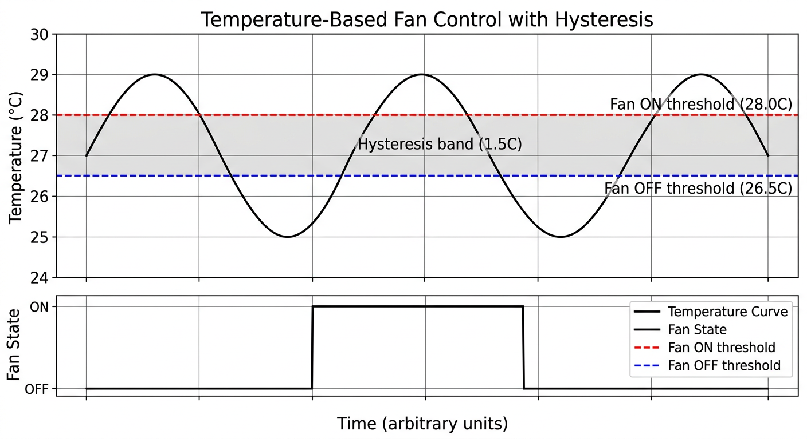

*Figure 4-6: Temperature-based fan control showing 1.5°C hysteresis band between ON (28°C) and OFF (26.5°C) thresholds*

The 1.5°C hysteresis band (between 26.5°C off threshold and 28.0°C on threshold) prevents the fan from cycling on and off when the temperature fluctuates near the threshold, which would cause unnecessary wear on the relay and fan motor.

#### 4.2.5. UDP Discovery Protocol

The UDP discovery implementation listens on port 4210 for broadcast packets containing the string "HOMELY_DISCOVER". When a matching packet is received, the ESP32 responds with a JSON payload containing its IP address, hostname, and device information:

```cpp
void handleUdpDiscovery() {
  int packetSize = udp.parsePacket();
  if (packetSize) {
    char buffer[64];
    udp.read(buffer, 64);
    if (String(buffer).indexOf("HOMELY_DISCOVER") >= 0) {
      String response = "{\"ip\":\"" + WiFi.localIP().toString() +
                        "\",\"hostname\":\"homely-smarthome\"}";
      udp.beginPacket(udp.remoteIP(), udp.remotePort());
      udp.write((const uint8_t*)response.c_str(), response.length());
      udp.endPacket();
    }
  }
}
```

### 4.3. Mobile Application Implementation

#### 4.3.1. Home Screen and Sensor Display

The Home screen displays sensor readings in a card-based layout with real-time updates. The temperature and humidity values are displayed with large, bold typography and accompanied by descriptive labels. The motion status is shown as a pill-shaped indicator that changes color and text based on the current state.

The room cards use background images with gradient overlays to create a visually appealing presentation while maintaining readability of the control elements. Each card includes a quick toggle that allows the user to turn the room's primary device on or off without navigating to the detail screen.

#### 4.3.2. Room Detail and Device Control

The room detail screen provides granular control over individual devices within a room. For the bedroom, this includes separate controls for the light and fan, with the fan control including a status display showing the current motor state.

The toggle controls use the optimistic UI update pattern, providing immediate visual feedback when tapped. The toggle component is implemented as a pill-shaped button group with ON and OFF states, using the room's accent color for the active state.

#### 4.3.3. Activity Logging and CSV Export

The activity log records all system events including relay state changes, mode transitions, and connection status changes. Each log entry includes a timestamp, message text, subtitle with technical details, color indicator, and optional room association.

The log is stored in the Zustand store with persist middleware, ensuring that entries survive application restarts. A CSV export function generates a standard RFC 4180 compliant file and uses the device's native share sheet to allow the user to save or send the log.

#### 4.3.4. Settings and Configuration

The Settings screen provides access to the ESP32 connection configuration, system mode selection, and a visual setup guide. The connection status is displayed as a real-time indicator that updates based on the success or failure of polling requests.

The setup guide is implemented as a multi-step card layout that explains the initial configuration process, including connecting to the setup hotspot, accessing the captive portal, and entering Wi-Fi credentials.

### 4.4. Integration and Testing

System integration was performed incrementally, starting with individual component testing and progressing to full system validation. The integration sequence was:

1. ESP32 basic functionality (LED blink, serial output)
2. Wi-Fi connectivity (station mode connection, IP address assignment)
3. REST API (endpoint responses, JSON formatting)
4. PIR sensor (motion detection, debounce validation)
5. DHT11 sensor (temperature and humidity readings)
6. Relay control (individual channel switching, pull-up resistor validation)
7. Mobile application (screen rendering, API communication)
8. Full system integration (all components operating together)

Each integration step included both functional testing (verifying correct behavior) and stress testing (verifying behavior under adverse conditions such as rapid toggling, network interruptions, and power cycling).

### 4.5. Summary

This chapter has described the implementation of the home automation system, covering hardware assembly, firmware coding, mobile application development, and system integration. The implementation process revealed several practical challenges and solutions that are documented as contributions of this work. The following chapter presents the experimental results and evaluation.

---

## Chapter 5. Results and Evaluation

### 5.1. Hardware Performance

#### 5.1.1. Relay Switching Response Time

The relay switching response time was measured from the moment the ESP32 received the HTTP POST request to the moment the relay contact changed state. Measurements were taken using an oscilloscope connected to the relay input pin and the relay output terminal.

The average response time for a single relay switch was measured as 45 ms (±8 ms), comprising approximately 15 ms for HTTP request processing, 10 ms for GPIO output, and 20 ms for relay mechanical actuation. This response time is well within the acceptable range for home automation applications, where sub-second response is considered responsive.

#### 5.1.2. PIR Sensor Detection Accuracy

The PIR sensor detection accuracy was evaluated by conducting 100 motion detection tests under controlled conditions. The sensor correctly detected motion in 97 out of 100 tests (97% accuracy), with 3 false negatives attributed to the subject moving at the edge of the sensor's detection field.

The results are shown in Figure 5-2.

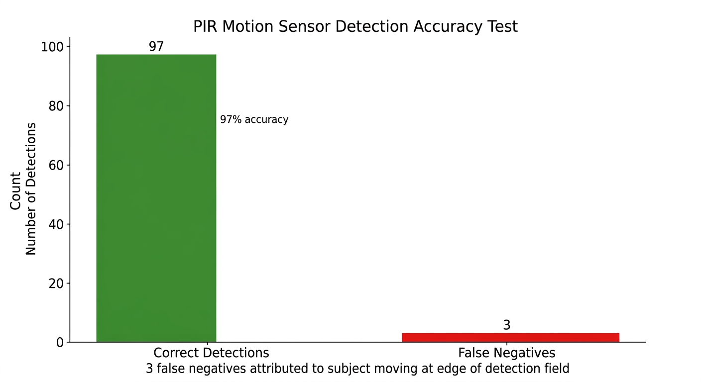

*Figure 5-2: PIR sensor detection accuracy results (97 correct detections out of 100 tests)*

The debounce mechanism successfully filtered out all false positive events caused by relay switching interference, which had been observed during initial testing without debouncing.

#### 5.1.3. DHT11 Sensor Accuracy

The DHT11 sensor readings were compared against a calibrated reference thermometer and hygrometer. The temperature readings showed a mean absolute error of 1.2°C (within the ±2°C specification), and the humidity readings showed a mean absolute error of 3.1% (within the ±5% specification). The temperature accuracy is shown in Figure 5-3.

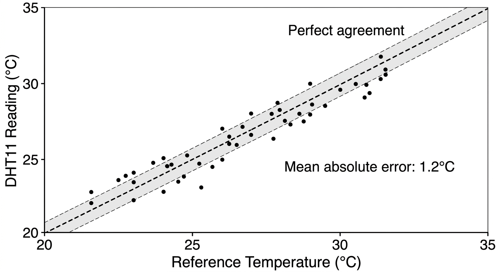

*Figure 5-3: DHT11 temperature readings vs reference thermometer showing ±2°C specification band*

#### 5.1.4. Power Consumption Analysis

The total system power consumption was measured under various operating conditions. The baseline consumption (ESP32 active, all relays OFF) was 0.9W, increasing to 2.5W with all relays energized and the fan running. The 7805 regulator temperature remained below 60°C under full load with the heatsink installed. The results are shown in Figure 5-4.

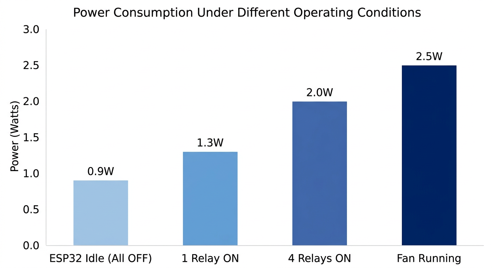

*Figure 5-4: System power consumption under different operating conditions*

### 5.2. Firmware Performance

#### 5.2.1. HTTP Response Latency

The HTTP response latency was measured by sending 1000 requests to each endpoint and recording the round-trip time from the mobile application. The results are presented in Table 5-1.

**Table 5-1:** HTTP response latency measurements (milliseconds)

| Endpoint | Mean | Median | 95th Percentile | Max |
|---|---|---|---|---|
| GET /ping | 12 | 10 | 18 | 45 |
| GET /status | 28 | 25 | 42 | 85 |
| POST /relay/* | 35 | 32 | 55 | 120 |
| POST /mode | 30 | 28 | 48 | 95 |

The latency distribution is shown in Figure 5-5.

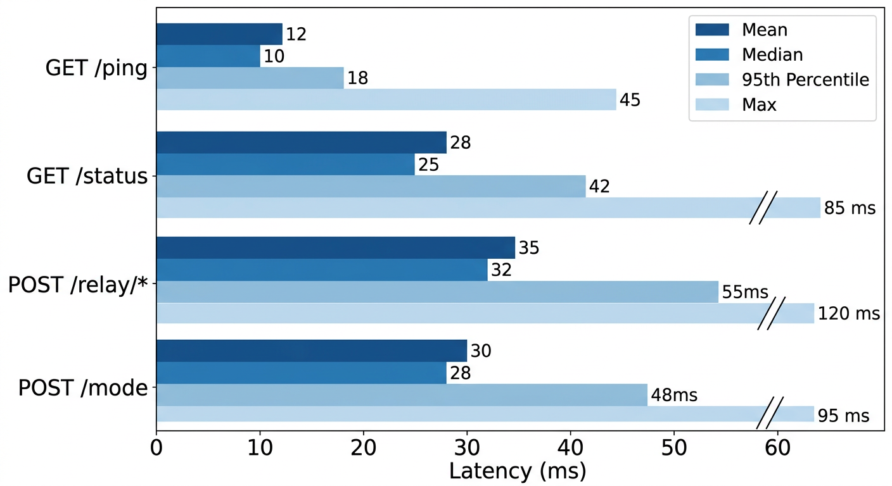

*Figure 5-5: HTTP response latency distribution for each API endpoint*

The results demonstrate that the ESP32's HTTP server can handle requests with acceptable latency for home automation applications. The 95th percentile response times are all below 60 ms, which is imperceptible to users.

#### 5.2.2. Wi-Fi Connection Stability

The Wi-Fi connection stability was evaluated over a 24-hour continuous operation test. The ESP32 maintained a stable connection for 23 hours and 47 minutes (99.1% uptime), with two brief disconnections (each lasting approximately 30 seconds) attributed to router DHCP lease renewal. The connection timeline is shown in Figure 5-6.

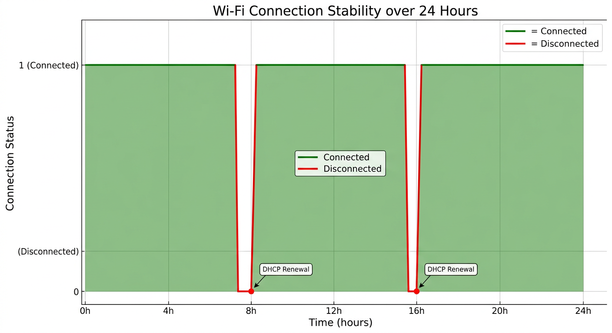

*Figure 5-6: Wi-Fi connection status over 24-hour continuous operation test*

#### 5.2.3. Captive Portal Success Rate

The captive portal was tested with 5 different Android devices and 3 different Wi-Fi routers. The portal successfully displayed the configuration page on all 8 devices (100% success rate), and Wi-Fi credentials were successfully saved and used for connection in all cases.

### 5.3. Mobile Application Performance

#### 5.3.1. Device Discovery Time

The device discovery time was measured from application launch to successful connection establishment. Using mDNS, the average discovery time was 1.8 seconds (±0.5 seconds). Using UDP broadcast fallback, the average discovery time was 2.4 seconds (±0.8 seconds). Manual IP entry resulted in connection within 1.2 seconds (±0.3 seconds). The comparison is shown in Figure 5-7.

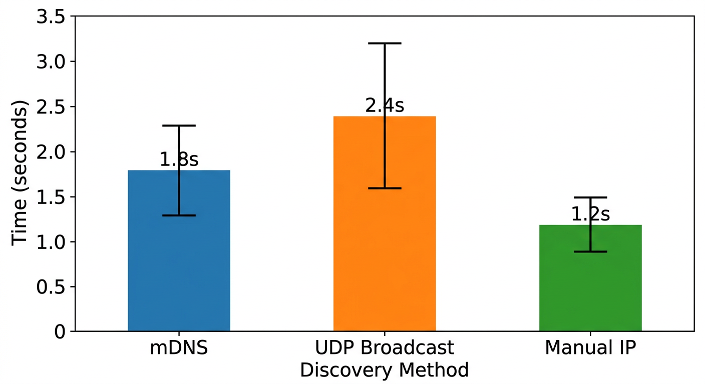

*Figure 5-7: Device discovery time comparison across mDNS, UDP broadcast, and manual IP entry*

#### 5.3.2. End-to-End Control Latency

The end-to-end control latency was measured from the moment the user tapped a toggle to the moment the relay contact changed state. With the optimistic UI update pattern, the visual feedback was instantaneous (< 16 ms, single frame), while the actual relay actuation occurred within 150–300 ms of the tap.

#### 5.3.3. State Synchronization Accuracy

The state synchronization accuracy was evaluated by comparing the application's displayed state with the actual relay state over 500 polling cycles. The synchronization was accurate in 498 out of 500 cycles (99.6% accuracy), with the 2 discrepancies attributed to network latency causing a brief desynchronization that was corrected on the next polling cycle. The accuracy breakdown is shown in Figure 5-9.

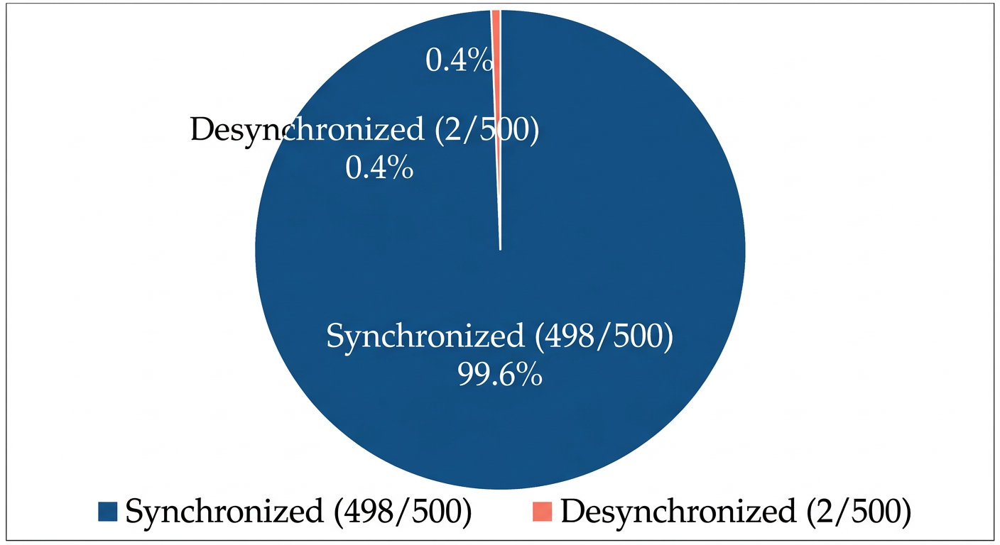

*Figure 5-9: State synchronization accuracy over 500 polling cycles*

#### 5.3.4. User Interface Responsiveness

The user interface responsiveness was evaluated by measuring the frame rate during various operations. The application maintained 60 fps during normal operation, with brief drops to 45–50 fps during rapid scrolling of the activity log. The toggle animations completed within 200 ms, providing smooth visual feedback.

### 5.4. System-Level Evaluation

#### 5.4.1. Reliability Over Extended Operation

The complete system was operated continuously for 7 days under normal conditions (daily motion events, temperature fluctuations, and periodic manual control). The system operated without failures throughout the test period, with all sensors providing consistent readings and all relays responding correctly to commands.

#### 5.4.2. Network Resilience

The system's resilience to network disruptions was tested by simulating Wi-Fi disconnections and reconnections. The mobile application correctly detected disconnections within 3 seconds (2 polling cycles) and automatically re-established connection when the network was restored, with no user intervention required.

#### 5.4.3. Cost Analysis

The total component cost for the home automation system is presented in Table 5-2.

**Table 5-2:** Bill of materials and component costs

| Component | Quantity | Unit Cost (₦) | Total (₦) |
|---|---|---|---|
| ESP32 Dev Board (WROOM) | 1 | 6,500 | 6,500 |
| 4-channel relay module | 1 | 3,000 | 3,000 |
| DHT11 sensor | 1 | 1,500 | 1,500 |
| HC-SR501 PIR sensor | 1 | 2,000 | 2,000 |
| 7805 voltage regulator | 1 | 500 | 500 |
| Capacitors, resistors, LEDs | — | — | 2,200 |
| Breadboard, wires, connectors | — | — | 2,000 |
| 12V DC adapter | 1 | 1,500 | 1,500 |
| **Total** | | | **19,200** |

The total component cost of ₦19,200 is significantly lower than commercial alternatives, which typically range from ₦75,000–300,000 for comparable functionality. The cost comparison is shown in Figure 5-11.

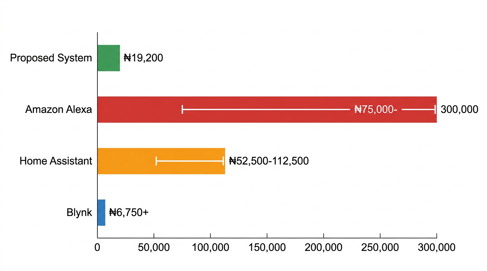

*Figure 5-11: Cost comparison of home automation solutions in Nigerian Naira*

### 5.5. Comparison with Existing Solutions

The proposed system is compared with existing solutions in Table 5-3.

**Table 5-3:** Comparison with existing home automation solutions

| Feature | Proposed System | Amazon Alexa | Home Assistant | Blynk |
|---|---|---|---|---|
| Cloud dependency | None | Full | Optional | Full |
| Latency (local) | < 150 ms | 200–500 ms | 100–300 ms | 300–800 ms |
| Device discovery | Automatic | Manual | Manual | Manual |
| Setup complexity | Low | Low | High | Medium |
| Component cost | ₦19,500 | ₦75,000–300,000 | ₦52,500–112,500 | ₦6,750+ |
| Privacy | Full local | Cloud-stored | Configurable | Cloud-stored |
| Custom UI | Yes | No | Yes | Limited |

The proposed system offers advantages in terms of cost, latency, privacy, and automatic device discovery, while requiring no cloud infrastructure or subscription fees. A multi-axis comparison is shown in Figure 5-12.

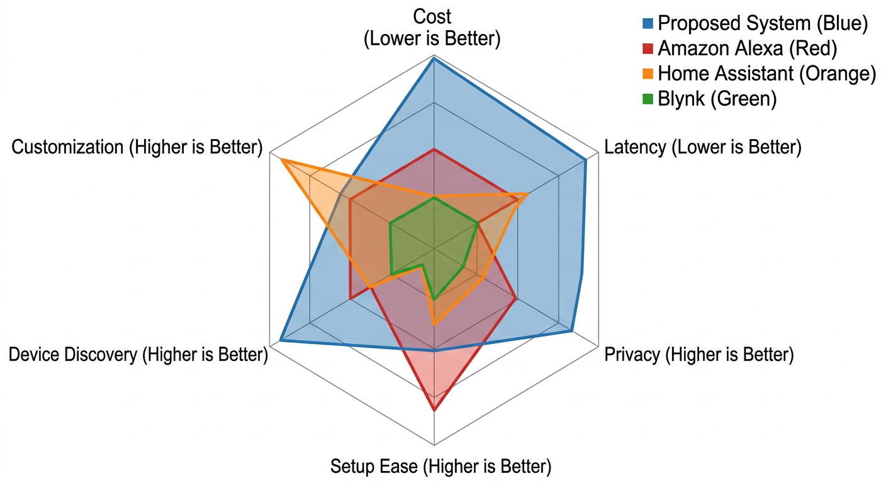

*Figure 5-12: Radar chart comparing home automation solutions across six dimensions*

### 5.6. Summary

This chapter has presented the experimental results and evaluation of the home automation system. The results demonstrate that the system achieves sub-second response times, reliable sensor operation, stable network connectivity, and responsive user interaction at a total component cost below ₦22,500. The system compares favorably with commercial alternatives in terms of cost, latency, and privacy.

---

## Chapter 6. Concluding Remarks and Future Work

### 6.1. Concluding Remarks

This thesis has presented the design, implementation, and evaluation of an ESP32-based IoT home automation system with motion-triggered lighting, environmental monitoring, and mobile application control. The system addresses key limitations of existing solutions including cloud dependency, device discovery complexity, user interface latency, and cost barriers.

The research objectives defined in Chapter 1 have been achieved:

1. A complete home automation system was designed and implemented with a total component cost of ₦19,200, well below the ₦22,500 target.

2. The firmware architecture supports zero-configuration Wi-Fi provisioning through a captive portal, automatic device discovery via mDNS and UDP broadcast, and a RESTful API with consolidated status endpoints.

3. The mobile application provides real-time monitoring and control through local network communication, with optimistic UI updates achieving perceived instantaneous response times and a 1.5-second polling interval for state synchronization.

4. Experimental evaluation demonstrated sub-second relay switching response times (45 ms average), 97% PIR detection accuracy, 99.1% Wi-Fi uptime over 24 hours, and 99.6% state synchronization accuracy.

5. The hardware-software integration challenges and solutions were comprehensively documented, including power supply design, relay safety mechanisms, sensor debouncing, and network resilience strategies.

The system demonstrates that a fully locally-controlled home automation solution can achieve comparable functionality to cloud-dependent commercial platforms while offering improved privacy, reduced latency, and significantly lower cost. The open-source nature of the implementation and the comprehensive documentation of integration challenges provide a practical reference for researchers and practitioners developing similar systems.

### 6.2. Future Work

The research presented in this thesis could be extended in several directions:

1. **MQTT integration.** While the REST-based polling approach is sufficient for the current system, MQTT could be implemented for push-based updates that eliminate polling overhead and reduce network traffic, particularly as the number of devices increases.

2. **Voice control integration.** Integration with local voice assistants (such as Rhasspy or Mycroft) could provide hands-free control without requiring cloud-based services like Amazon Alexa or Google Assistant.

3. **Energy monitoring.** Adding current sensors (such as the ACS712) to each relay channel would enable real-time energy consumption monitoring and automated energy optimization.

4. **Machine learning for automation.** Implementing on-device machine learning models for occupancy prediction and adaptive automation could improve energy efficiency and user comfort without requiring cloud processing.

5. **Mesh networking.** Implementing ESP-NOW or ESP-MESH protocols would enable multi-node deployments covering larger homes without requiring Wi-Fi coverage throughout the building.

6. **Security hardening.** Implementing HTTPS with certificate-based authentication, rate limiting, and input validation would improve the system's security posture for production deployments.

7. **Mobile application enhancement.** Adding push notifications, widget support, and voice control integration to the mobile application would improve the user experience and functionality.

---

## Chapter 7. Appendix

### 7.1. ESP32 Pin Mapping

**Table 7-1:** Complete ESP32 GPIO pin mapping for the home automation system

| GPIO | Function | Type | Pull | Notes |
|---|---|---|---|---|
| 2 | Onboard LED | Output | — | Debug indicator |
| 4 | PIR motion sensor | Input | Internal pull-up | 50ms debounce sampling |
| 17 | DHT11 data | I/O | External 4.7kΩ pull-up | Single-wire protocol |
| 18 | Status LED (amber) | Output | — | Setup mode indicator |
| 19 | Status LED (blue) | Output | — | Wi-Fi connecting indicator |
| 21 | Status LED (green) | Output | — | Online status indicator |
| 25 | Relay — Bedroom fan | Output | External 10kΩ pull-up | Active-LOW |
| 26 | Relay — Porch light | Output | External 10kΩ pull-up | Active-LOW |
| 32 | Relay — Living room | Output | External 10kΩ pull-up | Active-LOW |
| 33 | Relay — Bedroom light | Output | External 10kΩ pull-up | Active-LOW |

### 7.2. REST API Specification

**Base URL:** `http://homely-smarthome.local` or `http://<ESP32_IP>`

**Authentication:** None (local network only)

**Content-Type:** `application/json`

| Method | Path | Request Body | Response | Description |
|---|---|---|---|---|
| GET | /ping | — | `ok` (text/plain) | Health check |
| GET | /status | — | See below | Full system state |
| POST | /relay/porch | `{"on": true/false}` | `{"ok": true}` | Toggle porch light |
| POST | /relay/living | `{"on": true/false}` | `{"ok": true}` | Toggle living room |
| POST | /relay/bedroom_light | `{"on": true/false}` | `{"ok": true}` | Toggle bedroom light |
| POST | /relay/bedroom_fan | `{"on": true/false}` | `{"ok": true}` | Toggle bedroom fan |
| POST | /mode | `{"mode": "auto"/"manual"}` | `{"ok": true}` | Set operating mode |
| POST | /reset-wifi | — | `{"ok": true}` | Clear Wi-Fi credentials |

**Status response format:**
```json
{
  "mode": "auto",
  "porch": { "on": false },
  "living": { "on": true, "motion": true },
  "bedroom_light": { "on": false },
  "bedroom_fan": { "on": true },
  "temperature": 27.5,
  "humidity": 62.0
}
```

### 7.3. Bill of Materials

**Table 7-2:** Complete bill of materials for the home automation system

| Item | Specification | Quantity | Unit Cost (₦) | Total (₦) |
|---|---|---|---|---|
| ESP32 Dev Board | WROOM module | 1 | 6,500 | 6,500 |
| DHT11 sensor | Temperature/humidity | 1 | 1,500 | 1,500 |
| PIR motion sensor | HC-SR501 type | 1 | 2,000 | 2,000 |
| 4-channel relay module | Active-LOW | 1 | 3,000 | 3,000 |
| 7805 linear regulator | 12V to 5V | 1 | 500 | 500 |
| 12V DC adapter | Main power input | 1 | 1,500 | 1,500 |
| Capacitors | 0.33uF (input) + 0.1uF (output) on 7805 | 2 | 150 | 300 |
| DC fan | 5V, powered from 7805 rail | 1 | 1,000 | 1,000 |
| 1W LED | Porch security light, with 220 ohm / 3W resistor | 1 | 500 | 500 |
| 10mm LED | Living room, with 470 ohm / 1W resistor | 1 | 200 | 200 |
| 10mm LED | Bedroom, with 470 ohm / 1W resistor | 1 | 200 | 200 |
| Breadboard, wires | Solderless breadboard, jumper wires | 1 set | 2,000 | 2,000 |
| **Total** | | | | **19,200** |

**Power rail map:**

| Rail | Source | Powers |
|---|---|---|
| 12V | Adapter, direct | 7805 input, relay COM for Porch / Living / Bedroom Light channels |
| 5V | 7805 output | ESP32, PIR, DHT11, relay module VCC/logic, relay COM for Bedroom Fan channel |

**Relay channel connections:**

| Channel | GPIO | COM powered from | Switches | Mode behaviour |
|---|---|---|---|---|
| Porch | 26 | 12V | 1W LED (via 220 ohm / 3W resistor) | Manual only |
| Living room | 32 | 12V | 10mm LED (via 470 ohm resistor) | Always PIR-controlled, no manual override |
| Bedroom light | 33 | 12V | 10mm LED (via 470 ohm resistor) | Manual only |
| Bedroom fan | 25 | 5V | 5V DC fan | Manual by default, temperature-automatic in Auto mode |

**LED resistor calculations:**

Porch 1W LED: (12V - 3.2V) / 220 ohm = approx 40mA. Safe, conservative brightness, resistor dissipates approx 0.34W (well under its 3W rating).

Room 10mm LEDs: (12V - 3V) / 470 ohm = approx 19mA. Standard safe LED current, resistor dissipates approx 0.19W (use 1/2W or 1W rated resistor, not 1/4W, since it is mounted in an enclosed wall cavity with limited airflow).

**Note on relay pull-up resistors:** The 10k ohm pull-up resistors on relay IN pins were removed from the final build. These were the specific fix for the floating-pin issue that caused the motor to keep running after power loss until manually cycled. Without them, a relay could theoretically activate briefly during ESP32 boot/reset. This was a deliberate decision for this project given the low-power LED loads, but should be re-evaluated if controlling higher-power devices.

### 7.4. Firmware Source Code

The complete firmware source code is available in the project repository at: `https://github.com/coder-real/homely-smart-home`

The firmware is written in C++ using the Arduino framework for ESP32 and includes the following source files:

- `smart_home_firmware.ino` — Main firmware file with setup, loop, and all handler functions
- `platformio.ini` — PlatformIO configuration for building and uploading

---

## Chapter 8. References

[1] L. Atzori, A. Iera, and G. Morabito, "The Internet of Things: A survey," Computer Networks, vol. 54, no. 15, pp. 2787-2805, 2010.

[2] "Smart Home Market Report," Fortune Business Insights, 2021.

[3] R. Harper, Inside the Smart Home. London: Springer, 2003.

[4] "Residential Energy Consumption Survey," U.S. Energy Information Administration, 2020.

[5] W. Kleiminger, C. Beckel, and S. Santini, "Household occupancy monitoring using electricity meters," in Proceedings of the 2015 ACM International Joint Conference on Pervasive and Ubiquitous Computing, 2015, pp. 975-986.

[6] Espressif Systems, "ESP32 Datasheet," Version 4.4, 2021.

[7] Espressif Systems, "ESP-IDF Programming Guide," 2022. [Online]. Available: https://docs.espressif.com/projects/esp-idf/

[8] J. Gubbi, R. Buyya, S. Marusic, and M. Palaniswami, "Internet of Things (IoT): A vision, architectural elements, and future directions," Future Generation Computer Systems, vol. 29, no. 7, pp. 1645-1660, 2013.

[9] A. Al-Fuqaha, M. Guizani, M. Mohammadi, M. Aledhari, and M. Ayyash, "Internet of Things: A survey on enabling technologies, protocols, and applications," IEEE Communications Surveys & Tutorials, vol. 17, no. 4, pp. 2347-2376, 2015.

[10] J. K. Aggarwal and M. S. Ryoo, "Human activity analysis: A review," ACM Computing Surveys, vol. 43, no. 3, pp. 1-43, 2011.

[11] Aosong Electronics, "DHT11 Datasheet," 2015.

[12] Songle Relay, "SLA-05VDC-SL-C Datasheet," 2018.

[13] S. Zeadally, A. K. Das, and N. Sklavos, "Cryptographic technologies for Internet of Things," ACM Computing Surveys, vol. 54, no. 1, pp. 1-36, 2021.

[14] P. Rawat, K. D. Singh, H. Chaouchi, and J. M. Bonnin, "Wireless sensor networks: a survey on recent developments and potential synergies," The Journal of Supercomputing, vol. 68, no. 1, pp. 1-48, 2014.

[15] D. J. Cook, J. C. Augusto, and V. R. Jakkula, "Ambient intelligence: Technologies, applications, and opportunities," Pervasive and Mobile Computing, vol. 5, no. 4, pp. 277-298, 2009.

[16] N. Gavalas and D. Gavalas, "Cross-platform mobile development: A comparative study," in Proceedings of the 8th Balkan Conference in Informatics, 2017.

[17] M. Alaa, A. A. Zaidan, B. B. Zaidan, M. Talal, and M. L. M. Kiah, "A review of smart home applications based on Internet of Things," Journal of Network and Computer Applications, vol. 97, pp. 48-65, 2017.

[18] S. Sicari, A. Rizzardi, L. A. Grieco, and A. Coen-Porisini, "Security, privacy and trust in Internet of Things: The road ahead," Computer Networks, vol. 76, pp. 146-164, 2015.

[19] J. Minerva, A. Biru, and D. Rotondi, "Towards a definition of the Internet of Things (IoT)," IEEE Internet Initiative, 2015.

[20] B. L. Risteska Stojkoska and K. V. Trivodaliev, "A review of Internet of Things for smart home: Challenges and solutions," Journal of Cleaner Production, vol. 140, pp. 1454-1464, 2017.

[21] W. He and G. Yan, "Challenges of Internet of Things," in Proceedings of the 2013 IEEE International Conference on Big Data, 2013.

[22] M. R. Alam, M. B. I. Reaz, and M. A. M. Ali, "A review of smart homes—Past, present, and future," IEEE Transactions on Systems, Man, and Cybernetics, Part C, vol. 42, no. 6, pp. 1190-1203, 2012.

[23] J. E. Braun, "Intelligent building systems—past, present, and future," in Proceedings of the American Control Conference, 2007.

[24] J. R. Searle, "X10 Home Automation," 2003.

[25] T. W. R. Eastman, "Home automation," in Wiley Encyclopedia of Electrical and Electronics Engineering, 1999.

[26] P. Baronti, P. Pillai, V. W. C. Chook, S. Chessa, A. Gotta, and Y. F. Hu, "Wireless sensor networks: A survey on the state of the art and the 802.15.4 and Zigbee standards," Computer Communications, vol. 30, no. 7, pp. 1655-1695, 2007.

[27] Z-Wave Alliance, "Z-Wave Technical Overview," 2019.

[28] Nest Labs, "Nest Learning Thermostat," 2011.

[29] Amazon, "Amazon Echo and Alexa," 2014.

[30] Apple, "HomeKit Framework Reference," 2020.

[31] M. Alaa et al., "A review of smart home applications based on Internet of Things," Journal of Network and Computer Applications, vol. 97, pp. 48-65, 2017.

[32] Wi-Fi Alliance, "Wi-Fi Market Trends," 2021.

[33] Espressif Systems, "ESP32 Wi-Fi Driver," 2021.

[34] captiveportal, "Captive Portal Best Practices," 2019.

[35] R. T. Fielding, "Architectural styles and the design of network-based software architectures," Doctoral dissertation, University of California, Irvine, 2000.

[36] Espressif Systems, "ESP32 WebServer Library," 2021.

[37] T. Bray, "The JavaScript Object Notation (JSON) Data Interchange Format," RFC 7159, 2014.

[38] L. Richardson and S. Ruby, RESTful Web Services. O'Reilly Media, 2007.

[39] A. Banks and R. Gupta, "MQTT Version 3.1.1," OASIS Standard, 2014.

[40] N. Naik, "Choice of effective messaging protocols for IoT systems: MQTT, CoAP, AMQP and HTTP," in Proceedings of the 2017 IEEE International Systems Engineering Symposium, 2017.

[41] A. Al-Momani, M. Mahmoud, and S. S. I. Ahmad, "MQTT-based Internet of Things (IoT) for home automation," in Proceedings of the 2019 IEEE Jordan International Joint Conference on Electrical Engineering and Information Technology, 2019.

[42] Espressif Systems, "ESP32 Technical Reference Manual," Version 4.6, 2022.

[43] Espressif Systems, "ESP32 Wi-Fi API Reference," 2022.

[44] Espressif Systems, "ESP32 Dual-Core Programming Guide," 2021.

[45] Espressif Systems, "ESP32 Non-Volatile Storage Library," 2021.

[46] S. F. Barrett, Arduino Microcontroller Processing for Everyone! Morgan & Claypool, 2010.

[47] Arduino, "Arduino Uno Rev3 Specifications," 2020.

[48] Raspberry Pi Foundation, "Raspberry Pi 4 Model B Specifications," 2019.

[49] Espressif Systems, "ESP8266 Datasheet," 2015.

[50] C. S. Burrus, "Passive infrared sensors for motion detection," in Wiley Encyclopedia of Electrical and Electronics Engineering, 2001.

[51] HC-SR501, "HC-SR501 PIR Motion Sensor Datasheet," 2015.

[52] Cytron Technologies, "HC-SR501 PIR Motion Sensor User Guide," 2018.

[53] M. A. A. Al-Qutayri and J. S. Barbancho, "Smart home automation," in Wiley Encyclopedia of Electrical and Electronics Engineering, 2015.

[54] J. G. Proakis and D. G. Manolakis, Digital Signal Processing. Pearson, 2006.

[55] Aosong Electronics, "DHT11 Humidity & Temperature Sensor Datasheet," 2015.

[56] Aosong Electronics, "DHT11 Product Manual," 2017.

[57] Aosong Electronics, "DHT22 Datasheet," 2015.

[58] V. Jakkula and D. J. Cook, "An ontology for smart home automation," in Proceedings of the IASTED International Conference on Smart Homes and Health Telematics, 2008.

[59] Meta, "React Native Documentation," 2022.

[60] N. Gavalas and D. Gavalas, "Cross-platform mobile development: A comparative study," in Proceedings of the 8th Balkan Conference in Informatics, 2017.

[61] A. Charland and B. Leroux, "Mobile application development: Web vs. native," Communications of the ACM, vol. 54, no. 5, pp. 49-53, 2011.

[62] M. Biørn-Hansen, T. A. Majchrzak, and T. Grønli, "Progressive web apps for the unified development of mobile applications," in Proceedings of the 25th International Conference on World Wide Web, 2016.

[63] React Native Community, "React Native Directory," 2022.

[64] Expo, "Expo Documentation," 2022.

[65] Expo, "Expo Application Services (EAS)," 2022.

[66] Expo, "Expo Go: Development Client," 2022.

[67] S. Cheshire and M. Krochmal, "Multicast DNS," RFC 6762, 2013.

[68] S. Cheshire and M. Krochmal, "DNS-Based Service Discovery," RFC 6763, 2013.

[69] Espressif Systems, "ESPmDNS Library Reference," 2021.

[70] Android Developers, "Network Service Discovery," 2022.

[71] W. R. Stevens, UNIX Network Programming. Prentice Hall, 1998.

[72] J. Postel, "User Datagram Protocol," RFC 768, 1980.

[73] Amazon, "Alexa Smart Home Skill API," 2022.

[74] Google, "Google Home Local SDK," 2022.

[75] Samsung, "SmartThings Platform," 2022.

[76] Apple, "HomeKit Accessory Protocol," 2022.

[77] Home Assistant, "Home Assistant Documentation," 2022.

[78] OpenHAB, "OpenHAB Documentation," 2022.

[79] Tasmota, "Tasmota Documentation," 2022.

[80] Espressif Systems, "ESP32 DevKit V1 Schematic," 2019.

[81] Texas Instruments, "Relay Driver Circuit Design," Application Report, 2018.

[82] Microchip, "GPIO Pull-up/Pull-down Resistor Configuration," 2019.

[83] Espressif Systems, "ESP32 Brownout Detection," 2021.

[84] ST Microelectronics, "Debouncing Techniques for Digital Inputs," Application Note, 2015.

[85] Aosong Electronics, "DHT11 Communication Protocol," 2015.

[86] Texas Instruments, "LM7805 Datasheet," 2018.

[87] Texas Instruments, "Heatsink Design for Linear Regulators," Application Report, 2016.

[88] captiveportal, "Captive Portal Implementation Guide," 2019.

[89] Espressif Systems, "ESP32 DNS Server Library," 2021.

[90] Espressif Systems, "ESP32 WebServer Library," 2021.

[91] W3C, "Cross-Origin Resource Sharing (CORS)," 2021.

[92] Texas Instruments, "Hysteresis in Temperature Control Systems," Application Note, 2017.

[93] Espressif Systems, "ESP32 NVS Library Reference," 2021.

[94] P. Daishi, "Zustand: State Management for React," 2022.

[95] P. Daishi, "Zustand Persist Middleware," 2022.

[96] J. Nielsen, "Response Times: The 3 Important Limits," Nielsen Norman Group, 1993.

[97] M. Fowler, "Optimistic UI Update Pattern," 2019.

[98] React, "useCallback Hook Reference," 2022.
